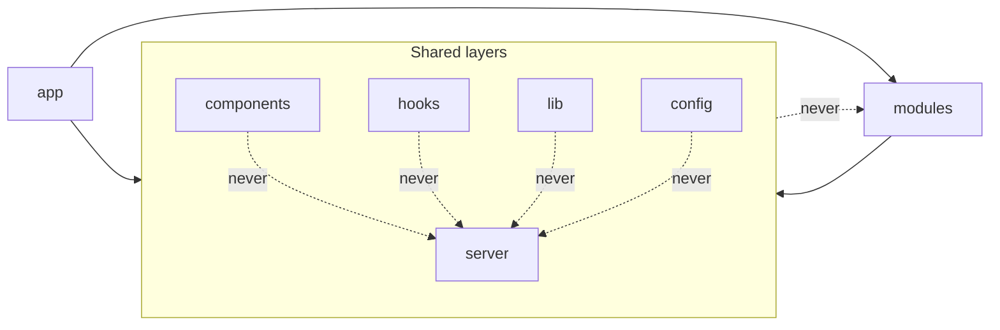
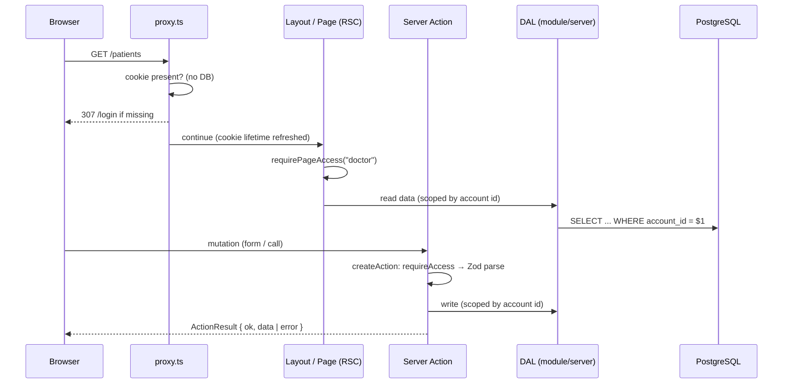

# Architecture

Doctor Handbook is a single Next.js full-stack application (a modular monolith). There is no
separate backend: pages, Server Actions and Route Handlers run on Vercel and talk to Supabase
(PostgreSQL + Storage) in the same region.

## Layers

```
src/
├── app/          Routes only: layouts, pages, route handlers. Thin; composes modules.
├── modules/      Feature modules (auth, admin, patients, search, todos, backup, feedback).
├── components/   Shared UI: ui/ (shadcn primitives), layout/, common/, providers/.
├── hooks/        Shared client hooks.
├── lib/          Pure, client-safe utilities: errors, results, validation, text, dates, enums.
├── config/       Static configuration: site, routes, navigation, env (server-only).
├── server/       Server-only infrastructure: db, auth, actions, storage, http, logger.
└── proxy.ts      Optimistic auth redirect + sliding session cookie.
```

Dependency direction (enforced by ESLint `no-restricted-imports`):



- Shared layers never import `@/modules/*` or `@/app/*`.
- Client-safe layers (`components`, `hooks`, `lib`, `config`) never import `@/server/*`.
- Every server-only file starts with `import "server-only"`, so an accidental client import
  fails the build.

## Feature modules

See [src/modules/README.md](../src/modules/README.md) for the standard module layout and rules.
In short: `server/queries.ts` and `server/mutations.ts` form the data access layer (DAL),
`server/actions.ts` exposes Server Actions built with `createAction`, and `schemas.ts` holds Zod
schemas shared by forms and actions.

## Request flow



## Authentication and authorization

| Concern              | Implementation                                                                                                                                               |
| -------------------- | ------------------------------------------------------------------------------------------------------------------------------------------------------------ |
| Passwords            | Argon2id (`server/auth/password.ts`)                                                                                                                         |
| Sessions             | Random 256-bit token in an httpOnly cookie; only its SHA-256 is stored (`sessions` table). No expiry; revoked by logout, password change/reset, account lock |
| Cookie lifetime      | 400 days, re-set by `proxy.ts` on each visit (browsers cap at 400 days)                                                                                      |
| Access codes         | 8 chars from an unambiguous alphabet, stored as HMAC-SHA256 keyed with `ACCESS_CODE_PEPPER`, single use, 72-hour TTL                                         |
| Page guard           | `requirePageAccess(level)` → redirect; a dead session goes through `/api/auth/clear-session`, which deletes the cookie and keeps `next`                      |
| Redirect targets     | Every `?next=` value passes `getSafeRedirectPath` (`lib/url.ts`) — same-origin relative paths only                                                           |
| API without session  | `proxy.ts` answers 401 JSON, never an HTML redirect                                                                                                          |
| Action / route guard | `requireAccess(level)` → `AppError("UNAUTHENTICATED" \| "FORBIDDEN")`                                                                                        |
| Data ownership       | DAL functions filter by `auth.account.id`; never trust an id from the client                                                                                 |
| Admin isolation      | Admin code paths never query `patients`, `notes` or `todos` (only count patients); the feedback inbox joins `accounts` for names only                        |
| Data API             | `.enableRLS()` (no policies) on every table + privileges of `anon` / `authenticated` revoked (`drizzle/0002_*`)                                              |

`getCurrentAuth()` is memoized per request with React `cache`, so a layout, a page and their
actions share a single session lookup.

## Errors and results

- Server code throws `AppError(code, message?)` (`lib/errors.ts`) for expected failures.
- `createAction` converts errors into `ActionResult` (`lib/result.ts`): `{ ok: true, data }` or
  `{ ok: false, error: { code, message, fieldErrors? } }`. Unexpected errors are logged and
  surfaced as `INTERNAL` without details.
- Forms use `createFormAction` (same pipeline, signature `(prevState, formData)`) with React's
  `useActionState` and `<form action={…}>`: the form posts even before JavaScript loads and can
  never fall back to a GET that would put field values in the URL. Its state is
  `FormActionState<T>` (`null` before the first submit).
- Route Handlers use `toErrorResponse` (`server/http/responses.ts`) for the same mapping.
- User-facing messages are Vietnamese; code, comments, logs and docs are English.

## Data

- Schema: `src/server/db/schema/*` (Drizzle, `snake_case` columns, UUID keys, `timestamptz`).
- Migrations: `drizzle/`, generated by `pnpm db:generate`, applied by `pnpm db:migrate`
  (production: automatically after a successful Vercel build). CI fails when the schema
  changes without a migration. Custom SQL (extensions, privileges) lives in custom migrations
  created with `pnpm exec drizzle-kit generate --custom --name=<name>`.
- Every table is declared with `.enableRLS()`, so the generated migration enables RLS.
- Integrity lives in the database too: lowercase-username CHECK, reset codes must target an
  account, and `notes (patient_id, account_id)` references `patients (id, account_id)` so a note
  always has the same owner as its patient.
- Migrations must be backward compatible (expand → migrate code → contract): they run while the
  previous deployment still serves traffic.
- Backup scope: every table of the doctor's notebook (patients, notes, avatars, to-dos)
  round-trips through backup and import. `feedback` does not: it is a message to the admin,
  `account_id ON DELETE SET NULL`, so it outlives a deleted account (spec `feedback`).
- Search: application-computed `search_text` (`normalizeVi`) + `pg_trgm` GIN indexes.
- Database access is lazy (`getDb()`), so builds never need credentials.

## Storage

Private Supabase buckets (`server/storage/objects.ts`). Object paths always start with the owner's
account id: storage functions only accept the branded `AccountObjectPath` returned by
`accountObjectPath(accountId, ...segments)`, which requires a UUID account id and rejects
`.`/`..` segments (path traversal). Browsers upload and download directly with signed URLs,
keeping files off Vercel functions (≈4.5 MB body limit).

- Bucket `avatars` (private): `<accountId>/<32 random hex>.(webp|jpg)`. A path sent back by a
  browser is accepted only if `isAvatarPathOf(sessionAccountId, path)`.
- Pictures are shown through `GET /api/patients/<id>/avatar`, which checks ownership and
  redirects to a signed URL; the storage path never reaches the browser.
- Deleting a doctor account (admin, D21) removes the whole `<accountId>/` folder with
  `removeAccountObjects` (lists that folder only, never the bucket) inside the transaction that
  deletes the account, so a storage failure keeps the account and its rows.
- CSP `img-src` / `connect-src` allow the origin of `SUPABASE_URL` (read at build time).
- E2E runs a fake Storage (`tests/e2e/fake-storage.mjs`, port 54321) implementing only the
  storage-js routes the app uses, plus `/__fake/*` routes the tests use to inspect objects.

## PWA (change `add-pwa-install`, spec `app-install`)

- `src/app/manifest.ts`: standalone, starts on `/patients`, PNG icons (192, 512, maskable 512) in
  `public/icons/`, `src/app/apple-icon.png` (opaque), shortcuts "Thêm bệnh nhân" / "Việc cần làm".
- `public/sw.js` (hand-written, registered by `PwaSetup` in production only; in development
  `PwaSetup` unregisters any leftover worker): cache-first for `/_next/static/*` (hashed),
  network-first for `/icons/*`, `/icon.svg`, `/offline.html` (unhashed, so deploys reach devices);
  page navigations always go to the network (navigation preload) and fall back to
  `/offline.html`; everything else (Server Actions, `/api/*`, signed Storage URLs) is not
  touched. Pages are never cached, so no patient data is ever stored. The allow-list is
  unit-tested on the file itself (`src/lib/pwa/service-worker.test.ts`).
- An inline script in the root layout keeps `beforeinstallprompt` even if it fires before
  hydration; `src/lib/pwa/install-prompt.ts` picks it up. Settings shows `InstallAppRow`
  (install button, dismissed, iPhone/iPad steps for every browser there, installed, unsupported).
- `src/proxy.ts` lets `icons/`, `sw.js` and `offline.html` through without a session.

### New deployments (version skew)

Every build gives Server Actions new IDs, so a page loaded before a deploy can no longer save:
Next answers its actions with `x-nextjs-action-not-found: 1` (`UnrecognizedActionError` on the
client). Handled in three places:

- `next.config.ts` sets `deploymentId` from `VERCEL_DEPLOYMENT_ID`: a client-side navigation
  across deployments becomes a full page load. It is also inlined as
  `NEXT_PUBLIC_DEPLOYMENT_ID`, and `/api/health` reports the live one.
- `src/lib/pwa/app-update.ts` (started by `PwaSetup`) wraps `fetch` once to spot that header on
  any action call, and compares with `/api/health` when the app returns to the foreground or comes
  back online. Either way a lasting toast offers "Tải lại".
- `src/app/error.tsx` shows "Ứng dụng vừa có bản mới" with "Tải lại trang" (not "Thử lại", which
  would resend the unknown action); the patient form keeps what was typed and says why it did not
  save. Note drafts survive the reload (IndexedDB).

E2E builds with `VERCEL_DEPLOYMENT_ID=dpl_e2e` (`tests/e2e/app-update.spec.ts`).

## Logging and privacy

Use `logger` from `server/logger.ts` only. Never log patient data or request bodies: log ids, error
codes and timings. Feedback text is never logged either (it may name a patient by mistake).

## Testing strategy

| Level      | Tool                            | Location                      |
| ---------- | ------------------------------- | ----------------------------- |
| Unit       | Vitest                          | next to the code, `*.test.ts` |
| End-to-end | Playwright (Pixel 7, iPhone 14) | `tests/e2e`                   |

Priority E2E scenarios once features exist: cross-account access returns 404; locking an account
ends its sessions immediately; backup → import round-trip.
