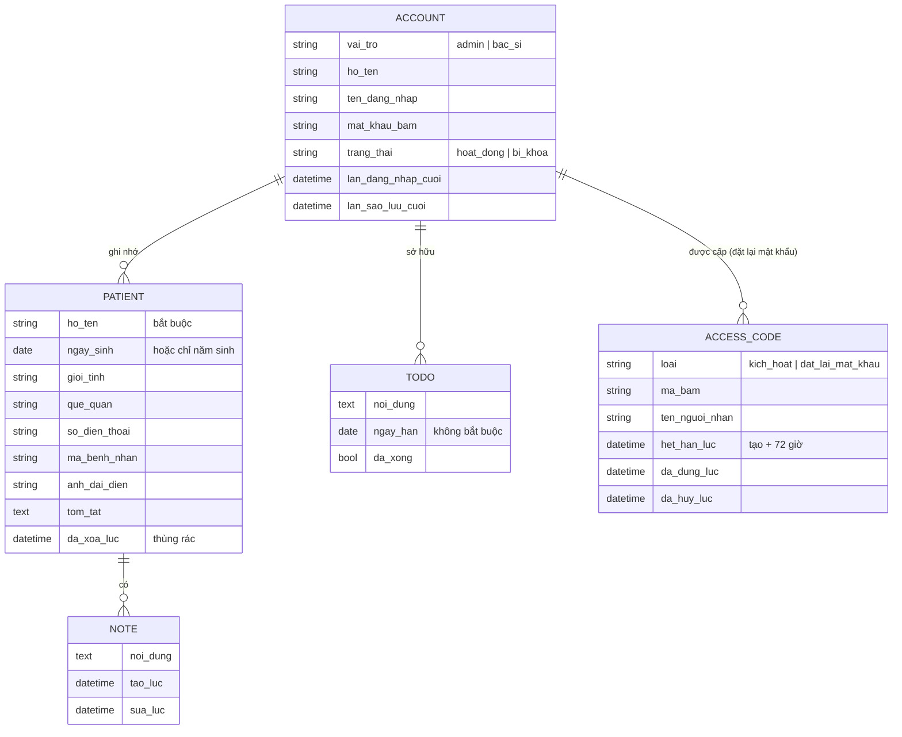
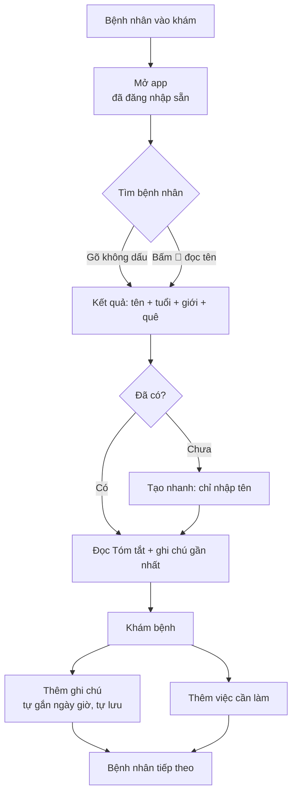
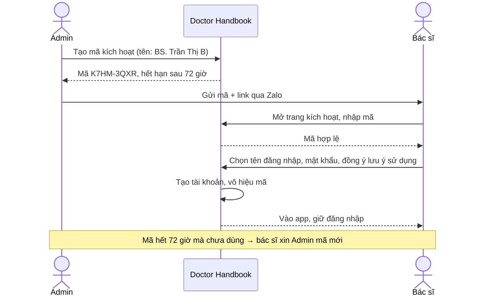
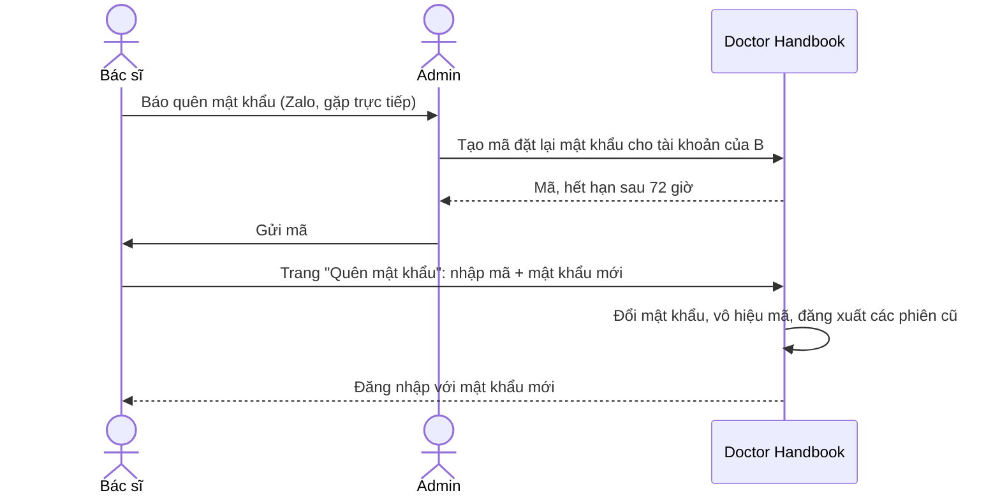
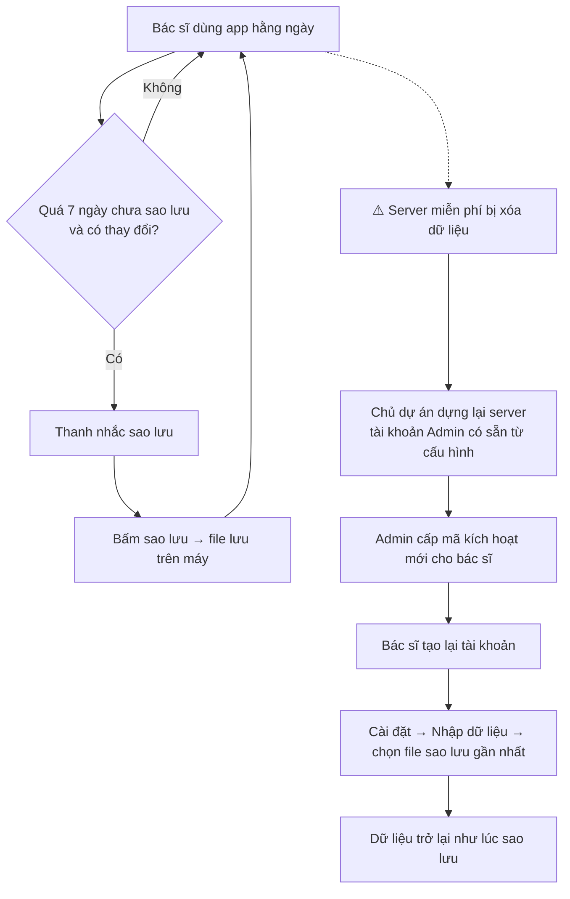

# Doctor Handbook — Sổ tay số cho bác sĩ

> **Phiên bản:** 1.2 — Ý tưởng đã chốt (kết thúc Phase 1 Requirement Discovery + Phase 2 Product Ideation)
> **Cập nhật:** 17/11/2026
> **Trạng thái:** ✅ Đã thống nhất, sẵn sàng sang Phase 3 (Business & Functional Analysis)
> **Lịch sử thay đổi:** xem mục 20

**Quy ước nhãn:**

| Nhãn | Ý nghĩa |
|---|---|
| ✅ **Confirmed** | Chủ dự án đã xác nhận |
| 🔶 **Assumption** | Giả định, cần xác nhận |
| 💡 **Recommendation** | Đề xuất của consultant |
| ❓ **Open Question** | Câu hỏi còn mở |

---

## 1. Tóm tắt

**Doctor Handbook** là ứng dụng web, dùng chủ yếu trên **điện thoại cá nhân**, giúp bác sĩ **thay thế cuốn sổ tay và cây bút cầm tay khi khám lâm sàng**. Bác sĩ dùng nó để:

1. **Ghi nhớ bệnh nhân** như một cuốn danh bạ: ai, bao nhiêu tuổi, quê đâu, cần lưu ý gì, các lần gặp đã ghi chú gì.
2. **Tìm lại bệnh nhân tức thì** bằng cách gõ (không cần dấu) hoặc đọc tên.
3. **Ghi các việc cần làm** dưới dạng danh sách đơn giản.
4. **Tự sao lưu dữ liệu** thành một file trên máy và **nhập lại** khi cần.

Tài khoản do **Admin cấp mã kích hoạt**, bác sĩ dùng mã để tự tạo tên đăng nhập và mật khẩu. Dữ liệu mỗi bác sĩ **riêng tư**, lưu trên server miễn phí. **Bác sĩ tự chịu trách nhiệm giữ bản sao lưu** vì server miễn phí không đảm bảo lưu trữ vĩnh viễn.

> **Định vị:** *Cuốn sổ tay bỏ túi của bác sĩ: ghi nhanh như viết tay, tìm lại nhanh hơn lật sổ, sao lưu được bất cứ lúc nào.*
> **Không phải:** hồ sơ bệnh án, phần mềm quản lý phòng khám, công cụ kê đơn.

---

## 2. Các quyết định đã chốt

| # | Chủ đề | Quyết định | Nhãn |
|---|---|---|---|
| D1 | Mục tiêu dự án | **Dùng nội bộ** cho một nhóm nhỏ, **miễn phí**, chưa có mục đích thương mại | ✅ |
| D2 | Tạo tài khoản | **Admin** (chủ dự án) tạo **mã kích hoạt hiệu lực 72 giờ**. Bác sĩ dùng mã để tự tạo tên đăng nhập và mật khẩu | ✅ |
| D3 | Quan hệ với phần mềm phòng khám | App **chỉ là sổ tay**, dùng **trên điện thoại khi khám lâm sàng**, ưu tiên tiện dụng | ✅ |
| D4 | Ranh giới pháp lý | App **không thay thế hồ sơ bệnh án** | ✅ |
| D5 | Todo | **Cơ bản**: bác sĩ ghi những việc cần làm | ✅ |
| D6 | Lịch sử bệnh | Tách thành **Tóm tắt** và **Ghi chú theo thời gian** | ✅ |
| D7 | Thông tin bệnh nhân | Thêm các trường cần thiết, tất cả **không bắt buộc** (trừ tên), gồm **Mã bệnh nhân** | ✅ |
| D8 | Lưu trữ dữ liệu | **Chấp nhận** dữ liệu trên server có thể bị xóa do dùng gói miễn phí. Bù lại bằng **Sao lưu ra file** trên máy bác sĩ và **Nhập dữ liệu** từ file khi muốn dùng lại | ✅ |
| D9 | Kiểm chứng | Sau khi xong các tính năng cơ bản, **cho một số bác sĩ dùng thử** | ✅ |
| D10 | Nền tảng | **Web**, dữ liệu lưu **database trên server**, không chỉ localStorage | ✅ |
| D11 | Tìm kiếm | Tìm bằng **text** và bằng **giọng nói** | ✅ |
| D12 | Hướng giải pháp | **Sổ tay cá nhân**, không chia sẻ dữ liệu giữa các bác sĩ | ✅ |
| D13 | Đăng nhập | Tên đăng nhập + mật khẩu. **Đăng nhập một lần, giữ đăng nhập mãi** cho đến khi bác sĩ tự đăng xuất, đổi/đặt lại mật khẩu, hoặc bị Admin khóa. Bác sĩ dùng máy cá nhân và **tự đảm bảo an toàn thiết bị**. Không có khóa PIN | ✅ |
| D14 | Đăng nhập Google | **Không dùng ở MVP.** Google miễn phí nhưng không giải quyết được việc kiểm soát ai được đăng ký và việc khôi phục tài khoản (mục 8.2) | ✅ |
| D15 | Ngày hạn cho todo | Có, không bắt buộc, không có thông báo | ✅ |
| D16 | Thiết bị | Thiết kế và kiểm thử cho cả iPhone và Android | ✅ |
| D17 | Mã kích hoạt | Hiệu lực **72 giờ**. Hết hạn mà bác sĩ chưa tạo tài khoản thì bác sĩ **liên hệ Admin xin mã mới** | ✅ |
| D18 | File sao lưu | **Không đặt mật khẩu.** Bác sĩ chủ động bảo vệ file của mình | ✅ |
| D19 | Tài khoản Admin | **Tách riêng** với tài khoản bác sĩ. Chủ dự án muốn dùng sổ tay thì dùng thêm một tài khoản bác sĩ | ✅ |
| D20 | Nhập dữ liệu | MVP chỉ **thay thế toàn bộ**, app tự sao lưu dữ liệu hiện tại trước khi thay. Gộp để sau | ✅ |
| D21 | Xóa tài khoản | Admin **được xóa** tài khoản bác sĩ (xóa luôn dữ liệu), phải gõ lại tên đăng nhập để xác nhận. Thông thường chỉ cần **khóa** | ✅ |

---

## 3. Problem Statement

Khi khám lâm sàng, bác sĩ cần nhớ nhiều thông tin **ngoài hồ sơ bệnh án chính thức**: đặc điểm riêng của bệnh nhân, điều cần lưu ý lần sau, việc phải làm sau buổi khám. Hiện họ ghi vào **sổ tay giấy**.

Sổ giấy **ghi rất nhanh** nhưng **tìm lại rất chậm**, **dễ mất**, **dễ lộ thông tin**, và **không tự sắp xếp**. Phần mềm của phòng khám thì không giải quyết được vì nó dành cho hồ sơ chính thức và không đủ nhanh khi đang đứng cạnh bệnh nhân.

**Doctor Handbook giữ lại tốc độ và sự tự do của sổ giấy, đồng thời bổ sung khả năng tìm kiếm, sắp xếp và sao lưu.**

| Tiêu chí | Sổ tay giấy | Doctor Handbook phải đạt |
|---|---|---|
| Tốc độ ghi | ⭐ Mở ra là viết | Ghi 1 ý trong **≤ 10 giây** |
| Tự do | ⭐ Viết gì cũng được | Ô text tự do, chỉ bắt buộc tên |
| Luôn mang theo | ⭐ Túi áo blouse | Mobile-first, thao tác một tay |
| Tìm lại | ❌ Lật từng trang | ⭐ Tìm ra trong **≤ 5 giây** |
| Mất, hỏng | ❌ Mất hết | ⭐ Có server + file sao lưu trên máy |
| Lộ thông tin | ❌ Ai nhặt cũng đọc được | ⭐ Phải đăng nhập |

---

## 4. Người dùng và bối cảnh

### 4.1 Vai trò

| Vai trò | Ai | Làm gì | Không được làm gì |
|---|---|---|---|
| **Admin** | Chủ dự án (chỉ một người) ✅ | Tạo mã kích hoạt, tạo mã đặt lại mật khẩu, xem danh sách tài khoản, khóa/mở khóa tài khoản | 💡 **Không xem được dữ liệu bệnh nhân** của bất kỳ bác sĩ nào |
| **Bác sĩ** | Người được Admin mời ✅ | Toàn bộ chức năng sổ tay trên dữ liệu của chính mình | Xem dữ liệu của bác sĩ khác |

✅ **Tài khoản Admin và tài khoản bác sĩ tách riêng (D19).** Chủ dự án muốn dùng sổ tay thì dùng thêm một tài khoản bác sĩ. Cách này giữ phân quyền đơn giản, và tài khoản Admin không bao giờ chứa dữ liệu bệnh nhân.

### 4.2 Người dùng chính: bác sĩ

| Thuộc tính | Mô tả | Nhãn |
|---|---|---|
| Quy mô | Nhóm nhỏ (🔶 khoảng 5–20 người) | ✅ / 🔶 |
| Thiết bị chính | **Điện thoại cá nhân**, dùng khi khám lâm sàng | ✅ |
| Thiết bị phụ | Máy tính, khi cần ghi chú dài | 🔶 |
| An toàn thiết bị | Bác sĩ tự chịu trách nhiệm | ✅ |

### 4.3 Bối cảnh khám lâm sàng: hệ quả cho thiết kế

| Đặc điểm bối cảnh | Hệ quả thiết kế 💡 |
|---|---|
| Thời gian giữa hai bệnh nhân rất ngắn | Mở app là thấy ô tìm kiếm và nút thêm. Không có màn hình chào, không có bước thừa |
| Thường đứng hoặc đang di chuyển, một tay cầm máy | Nút quan trọng nằm ở **nửa dưới màn hình**, vùng ngón cái chạm tới. Vùng bấm lớn |
| Tay có thể đang bận hoặc đeo găng | **Tìm bằng giọng nói** có giá trị thực tế |
| Bệnh nhân và người nhà đứng cạnh có thể nhìn vào màn hình | Danh sách không hiển thị nội dung nhạy cảm. Tóm tắt bệnh chỉ hiện khi mở chi tiết |
| Môi trường sáng mạnh, nhìn nhanh | Chữ đủ to, tương phản cao |
| Wifi/4G trong tòa nhà có thể chập chờn | Không được mất ghi chú đang gõ khi mất mạng |

---

## 5. Pain Points

| # | Pain point | Mức độ | Giải pháp |
|---|---|---|---|
| P1 | Lật sổ tìm thông tin mất thời gian | Cao | Tìm kiếm text không dấu và giọng nói |
| P2 | Mất hoặc hỏng sổ là mất toàn bộ | Cao | Dữ liệu trên server + **file sao lưu trên máy** bác sĩ |
| P3 | Sổ rơi vào tay người khác thì lộ thông tin bệnh nhân | Cao | Phải đăng nhập. Danh sách không hiện thông tin nhạy cảm |
| P4 | Quên việc cần làm | Trung bình | Todo đơn giản |
| P5 | Ghi chú lộn xộn, không biết ghi lúc nào | Trung bình | Ghi chú theo thời gian, tự gắn ngày giờ |
| P6 | Trùng tên, không nhớ ai là ai | Trung bình | Năm sinh, giới tính, quê, ảnh hiển thị cạnh tên |
| P7 | Khó đối chiếu với hồ sơ ở phần mềm phòng khám | Thấp | Trường **Mã bệnh nhân** để tra ngược sang phần mềm chính thức |

---

## 6. Mục tiêu và tiêu chí thành công

### 6.1 Mục tiêu sản phẩm

| # | Mục tiêu |
|---|---|
| G1 | Bác sĩ dùng thử **chuyển được thói quen** từ sổ giấy sang app cho việc ghi nhớ bệnh nhân |
| G2 | Tìm lại bệnh nhân nhanh hơn rõ rệt so với lật sổ |
| G3 | Bác sĩ **luôn có cách lấy lại dữ liệu**: từ server, hoặc từ file sao lưu nếu server mất dữ liệu |
| G4 | Vận hành **chi phí bằng 0** |

### 6.2 Tiêu chí đánh giá giai đoạn dùng thử (💡 đề xuất)

| Chỉ số | Mục tiêu gợi ý | Cách đo |
|---|---|---|
| Thời gian ghi 1 ghi chú (mở app → lưu xong) | ≤ 10 giây | Quan sát trực tiếp |
| Thời gian tìm 1 bệnh nhân | ≤ 5 giây | Quan sát trực tiếp |
| Bác sĩ còn dùng sau 4 tuần | ≥ 60% số người dùng thử | Lần đăng nhập cuối (Admin xem được) |
| Bác sĩ có ít nhất 1 bản sao lưu trong đợt dùng thử | 100% | Hỏi trực tiếp, hoặc ngày sao lưu gần nhất |
| Thử khôi phục từ file thành công | Ít nhất 1 lần thử trong đợt | Chủ dự án thử với tài khoản test |
| Bác sĩ có quay lại dùng sổ giấy không | Phần lớn trả lời "không" hoặc "ít" | Phỏng vấn cuối đợt |

---

## 7. Nguyên tắc sản phẩm

Sáu nguyên tắc dùng để quyết định mọi tính năng sau này. Một tính năng vi phạm nguyên tắc thì không đưa vào, dù nghe hữu ích.

| # | Nguyên tắc | Ví dụ áp dụng |
|---|---|---|
| **N1** | **Sổ ghi nhớ, không phải bệnh án** | Không có đơn thuốc, không có biểu mẫu chẩn đoán, không có in ấn bệnh án |
| **N2** | **Nhanh bằng sổ giấy khi ghi** | Chỉ bắt buộc tên. Lưu tự động, không có hộp thoại xác nhận khi lưu |
| **N3** | **Điện thoại trước, một tay** | Thiết kế cho điện thoại trước, máy tính là bản mở rộng |
| **N4** | **Ghi tối thiểu dữ liệu nhạy cảm** | Mọi trường ngoài tên đều không bắt buộc. Ảnh là tùy chọn |
| **N5** | **Dữ liệu thuộc về bác sĩ, bác sĩ giữ bản sao** | Bác sĩ xuất và nhập được toàn bộ dữ liệu của mình bất cứ lúc nào. App nhắc khi lâu chưa sao lưu |
| **N6** | **Admin quản lý tài khoản, không quản lý dữ liệu** | Màn hình Admin không có đường nào dẫn tới dữ liệu bệnh nhân |

---

## 8. Phân tích hệ quả của các quyết định

### 8.1 Miễn phí và chấp nhận server có thể mất dữ liệu (D1, D8)

Đây là thay đổi lớn nhất so với bản 1.0: **trách nhiệm giữ dữ liệu chuyển từ hệ thống sang bác sĩ**. Hệ quả:

| Hệ quả | Đề xuất 💡 |
|---|---|
| Nếu bác sĩ không sao lưu, khi server mất dữ liệu thì bác sĩ mất hết | Tính năng **nhắc sao lưu** là bắt buộc, không phải tùy chọn (mục 10.5) |
| Bác sĩ phải biết rõ điều này **trước** khi dùng | Thông báo rõ khi tạo tài khoản: "Dữ liệu trên server có thể bị mất. Hãy sao lưu thường xuyên." Bác sĩ phải tick đồng ý |
| Khi server mất dữ liệu, **tài khoản cũng mất**, không chỉ dữ liệu bệnh nhân | Luồng khôi phục: Admin cấp mã mới → bác sĩ tạo lại tài khoản → nhập file sao lưu. Xem luồng ở mục 12.5 |
| File sao lưu chứa **dữ liệu bệnh nhân**, nằm trên điện thoại và có thể bị gửi qua Zalo, Google Drive... | Đây là rủi ro bảo mật mới (mục 8.4) |
| Server mất dữ liệu thì tài khoản Admin cũng mất | Tài khoản Admin được tạo bằng **cấu hình lúc triển khai** (không qua giao diện), nên dựng lại server là có lại Admin |

### 8.2 Tài khoản qua Admin và mã kích hoạt (D2, D14)

**Trả lời câu hỏi về Google:** Đăng nhập bằng Google **không mất phí**. Google không thu tiền theo số lượt đăng nhập. Các dịch vụ xác thực phổ biến cũng đều cho dùng đăng nhập Google trong gói miễn phí. Chi phí duy nhất là công cấu hình một dự án trên Google Cloud.

**Tuy vậy, tôi vẫn khuyến nghị dùng phương án Admin + mã kích hoạt như bạn mô tả**, vì nó giải quyết được ba vấn đề cùng lúc mà không cần thêm dịch vụ nào:

| Vấn đề | Đăng nhập Google | Admin + mã kích hoạt |
|---|---|---|
| Chặn người ngoài nhóm đăng ký | ❌ Ai có Google cũng vào được, vẫn cần thêm cơ chế mời | ✅ Không có mã thì không tạo được tài khoản |
| Quên mật khẩu | ✅ Không có mật khẩu | ✅ Admin cấp **mã đặt lại mật khẩu**, cùng cơ chế với mã kích hoạt |
| Cần dịch vụ gửi email | Không | **Không**. Admin gửi mã qua Zalo/tin nhắn |
| Phụ thuộc bên thứ ba | Google | Không |
| Việc của Admin | Không có | Có một chút: tạo mã khi có người mới hoặc người quên mật khẩu. Với nhóm nhỏ thì chấp nhận được |

#### Thiết kế mã (💡 đề xuất)

| Thuộc tính | Đề xuất | Lý do |
|---|---|---|
| Hai loại mã | **Mã kích hoạt** (tạo tài khoản mới) và **Mã đặt lại mật khẩu** (cho tài khoản đã có) | Dùng chung một cơ chế, giải quyết việc quên mật khẩu mà không cần email |
| Hiệu lực | **72 giờ** ✅ | Theo yêu cầu. Hết hạn thì bác sĩ xin Admin mã mới (D17) |
| Số lần dùng | **Một lần**. Dùng xong hoặc hết hạn thì vô hiệu | Mã bị lộ sau khi dùng cũng không còn tác dụng |
| Độ dài, ký tự | 8 ký tự chữ in hoa và số, **bỏ các ký tự dễ nhầm** (O/0, I/1/L) | Dễ đọc qua điện thoại, dễ gõ |
| Thông tin kèm mã | Admin ghi **tên bác sĩ** khi tạo mã | Admin biết mã nào cấp cho ai |
| Thu hồi | Admin hủy được mã chưa dùng | Gửi nhầm người |
| Chống dò mã | Giới hạn số lần nhập sai mã từ một thiết bị/IP trong một khoảng thời gian | Mã 8 ký tự là đủ an toàn khi có giới hạn này |

#### Kích hoạt tài khoản

Bác sĩ mở trang kích hoạt → nhập mã → tự chọn **tên đăng nhập** và **mật khẩu** → tick đồng ý lưu ý sử dụng → vào app ngay.

| Quy tắc | |
|---|---|
| Tên đăng nhập | Không trùng, không phân biệt hoa thường, chỉ gồm chữ không dấu, số, dấu chấm, gạch dưới |
| Mật khẩu | Tối thiểu 8 ký tự. Không đặt quy tắc phức tạp (bắt buộc ký tự đặc biệt...) vì gây khó chịu khi gõ trên điện thoại |
| Admin | **Không bao giờ thấy mật khẩu** của bác sĩ |

### 8.3 Đăng nhập không hết hạn (D13)

Bác sĩ dùng máy cá nhân và tự đảm bảo an toàn thiết bị, nên **đăng nhập một lần là dùng mãi**. Không có khóa PIN, không bị tự đăng xuất. Đây là trải nghiệm nhanh nhất, đúng nguyên tắc N2.

**Phiên đăng nhập chỉ kết thúc khi:**

| Sự kiện | Phiên nào bị kết thúc |
|---|---|
| Bác sĩ bấm **Đăng xuất** | Phiên trên thiết bị đó |
| Bác sĩ **đổi mật khẩu** | Các phiên trên **thiết bị khác**. Thiết bị đang dùng vẫn giữ đăng nhập |
| Bác sĩ **đặt lại mật khẩu** bằng mã | **Mọi** phiên |
| Admin **khóa tài khoản** | **Mọi** phiên, có hiệu lực ngay |

**Hệ quả cần biết:** vì phiên không tự hết, khi mất điện thoại thì **Admin khóa tài khoản là lớp bảo vệ duy nhất**. Luồng xử lý: bác sĩ báo Admin → Admin khóa → khi có máy mới, Admin mở khóa và cấp mã đặt lại mật khẩu → bác sĩ đặt mật khẩu mới, mọi phiên cũ (kể cả trên máy bị mất) bị vô hiệu.

💡 Về kỹ thuật, "đăng nhập mãi" vẫn phải là phiên **thu hồi được** từ phía server. Không dùng loại token không thể thu hồi, vì khi đó Admin khóa tài khoản sẽ không có tác dụng với máy bị mất.

### 8.4 Sao lưu và nhập dữ liệu (D8)

Phân tích chi tiết ở mục 10.5. Các điểm phản biện chính:

| Vấn đề | Phân tích | Đề xuất 💡 |
|---|---|---|
| **Bác sĩ quên sao lưu** | Đây là rủi ro lớn nhất của D8. Không ai chủ động sao lưu nếu không được nhắc | Hiện **"Lần sao lưu gần nhất: X ngày trước"** trong Cài đặt. Hiện **thanh nhắc** trên màn hình chính khi quá 7 ngày chưa sao lưu và có dữ liệu thay đổi |
| **File sao lưu bị lộ** | File chứa toàn bộ dữ liệu bệnh nhân. Trên điện thoại, file dễ bị gửi qua Zalo, đồng bộ lên cloud, hoặc nằm trong thư mục Tải xuống | ✅ **Không mã hóa file (D18)**, bác sĩ tự bảo vệ. App hiện **lời nhắc ngắn mỗi lần sao lưu**: "File chứa thông tin bệnh nhân, không gửi cho người khác" |
| **Nhập vào tài khoản đã có dữ liệu** | Thay thế hết, hay gộp? Gộp phải xử lý trùng lặp, phức tạp hơn nhiều | ✅ MVP chỉ làm **Thay thế toàn bộ** (D20). Trước khi thay thế, app **tự tạo một file sao lưu dữ liệu hiện tại** để tránh mất do nhập nhầm. Gộp để Phase 2 |
| **File của phiên bản app cũ** | Sau này app thêm trường mới, file cũ vẫn phải nhập được | File có ghi **số phiên bản định dạng**. App đọc được mọi phiên bản cũ hơn |
| **Ảnh bệnh nhân** | Ảnh làm file lớn hơn nhiều | Ảnh đã được nén khi tải lên. Đưa ảnh vào cùng file sao lưu, vẫn là **một file duy nhất** ✅ |

### 8.5 Todo cơ bản (D5, D15)

| Thuộc tính | Quyết định |
|---|---|
| Nội dung (text) | MVP |
| Đánh dấu xong / chưa xong | MVP |
| Ngày hạn, không bắt buộc. Quá hạn thì tô đỏ, không có thông báo | MVP |
| Sắp xếp: chưa xong ở trên (có hạn sớm trước), đã xong thu gọn ở dưới | MVP |
| Gắn với bệnh nhân | Để sau, xem phản hồi dùng thử |
| Thông báo nhắc việc | Không làm hiện tại |

### 8.6 Bảo mật tối thiểu bắt buộc cho MVP

Dù là dự án nội bộ miễn phí, các mục sau **không được cắt bớt**, vì đây là dữ liệu bệnh nhân:

| # | Yêu cầu |
|---|---|
| S1 | HTTPS cho mọi kết nối |
| S2 | Mật khẩu được băm (hash) an toàn, không bao giờ lưu dạng đọc được. Mã kích hoạt và mã đặt lại cũng lưu dạng băm |
| S3 | **Mọi truy vấn dữ liệu đều lọc theo bác sĩ sở hữu.** Lỗi phổ biến nhất: bác sĩ A xem được bệnh nhân của bác sĩ B chỉ bằng cách đổi ID trên đường dẫn |
| S4 | Admin không có quyền đọc dữ liệu bệnh nhân (N6) |
| S5 | Ảnh bệnh nhân lưu ở kho riêng tư, không có đường link công khai |
| S6 | Giới hạn số lần đăng nhập sai và nhập mã sai |
| S7 | Danh sách bệnh nhân không hiển thị nội dung tóm tắt bệnh |
| S8 | Phiên đăng nhập thu hồi được từ server. Khóa tài khoản và đặt lại mật khẩu có hiệu lực ngay với mọi phiên đang đăng nhập |
| S9 | Lưu ý khi kích hoạt tài khoản: app là sổ ghi nhớ cá nhân, không thay thế hồ sơ bệnh án; dữ liệu server có thể mất, bác sĩ tự sao lưu; nên ghi tối thiểu thông tin cần thiết; giữ file sao lưu cẩn thận |

> ⚠️ Không phải tư vấn pháp lý. Nếu sau này mở rộng ra ngoài nhóm nhỏ hoặc thương mại hóa, cần rà soát lại theo quy định bảo vệ dữ liệu cá nhân (Nghị định 13/2023/NĐ-CP, Luật Bảo vệ dữ liệu cá nhân 2025) và quy định của Bộ Y tế.

---

## 9. Giải pháp được chọn

| | Nội dung |
|---|---|
| **Concept** | Mỗi bác sĩ có một cuốn sổ số riêng gồm Danh bạ bệnh nhân và Danh sách việc, tự sao lưu được ra file |
| **Core value** | Ghi nhanh như giấy, tìm nhanh hơn giấy, sao lưu được, không lộ |
| **Mô hình vận hành** | Một Admin cấp quyền truy cập. Hạ tầng miễn phí, không cam kết lưu trữ. Bác sĩ tự giữ bản sao |
| **Đã loại** | *Sổ tay phòng khám* (chia sẻ giữa bác sĩ): không có nhu cầu. *Mini EMR*: vi phạm N1 và D4. *Tự đăng ký tự do*: không kiểm soát được người dùng |

---

## 10. Chi tiết tính năng

### 10.1 Hồ sơ bệnh nhân

| Trường | Bắt buộc | Hiển thị ở danh sách | Ghi chú |
|---|---|---|---|
| Họ tên | ✅ | ✅ | Trường duy nhất bắt buộc |
| Năm sinh / ngày sinh | | ✅ (dạng tuổi) | Nhập năm sinh hoặc ngày sinh đầy đủ. App tự tính tuổi. Cho phép nhập nhanh "45t" và quy đổi ra năm sinh |
| Giới tính | | ✅ (biểu tượng) | Nam / Nữ / Khác |
| Quê quán | | ✅ | Text tự do |
| Số điện thoại | | | Bấm để gọi |
| **Mã bệnh nhân** ✅ | | | Mã ở phần mềm phòng khám, để tra ngược hồ sơ chính thức |
| Ảnh đại diện | | ✅ | Mặc định hiển thị chữ cái đầu. Chụp trực tiếp hoặc chọn ảnh. App tự nén ảnh |
| **Tóm tắt** | | ❌ | Text tự do: tiền sử, dị ứng, lưu ý. Tự nhận diện link |
| **Ghi chú theo thời gian** | | ❌ | Mới nhất ở trên, mỗi ghi chú tự gắn ngày giờ, sửa và xóa được |

**Màn hình chi tiết bệnh nhân (phác thảo):**

```
┌───────────────────────────────────┐
│ ←                          ✏️  ⋮  │
│  (NA)  Nguyễn Văn A               │
│        ♂ 47t · 1979 · Nghệ An     │
│        📞 0912 xxx xxx  · BN-10234│
├───────────────────────────────────┤
│ 📌 TÓM TẮT                         │
│ THA 5 năm. Dị ứng Penicillin.     │
│ Con gái là dược sĩ, hay hỏi kỹ.   │
├───────────────────────────────────┤
│ 🕒 GHI CHÚ                         │
│ 15/11/2026 09:12                  │
│   HA 150/90, tăng liều amlodipin  │
│ 02/10/2026 14:30                  │
│   Tái khám. KQ XN: https://...    │
│                                   │
│              [ + Ghi chú mới ]    │  ← vùng ngón cái
└───────────────────────────────────┘
```

**Quy tắc nghiệp vụ:**

| # | Quy tắc |
|---|---|
| BR1 | Chỉ bắt buộc họ tên. Cho phép lưu bệnh nhân chỉ với tên, bổ sung sau |
| BR2 | Cho phép trùng tên. Khi tạo mới mà đã có bệnh nhân trùng tên và năm sinh, hiện gợi ý "Có phải người này?" nhưng không chặn |
| BR3 | Xóa bệnh nhân thì chuyển vào **Thùng rác**, khôi phục được trong 30 ngày, sau đó xóa vĩnh viễn |
| BR4 | Ngày giờ của ghi chú do hệ thống gán khi tạo. Sửa nội dung không đổi ngày tạo, nhưng lưu thời điểm sửa gần nhất |
| BR5 | Bác sĩ chỉ thấy và thao tác trên dữ liệu của chính mình |

### 10.2 Tìm kiếm

| Yêu cầu | MVP |
|---|---|
| Ô tìm kiếm luôn ở trên cùng màn hình Bệnh nhân, kết quả hiện ngay khi gõ | ✅ |
| **Không phân biệt dấu và hoa thường**: "nguyen van a" ra "Nguyễn Văn A" | ✅ |
| Tìm theo tên, quê quán, số điện thoại, **mã bệnh nhân** | ✅ |
| Tìm trong nội dung Tóm tắt và Ghi chú (ví dụ "penicillin") | ✅ |
| Kết quả hiển thị tên, tuổi, giới tính, quê để phân biệt trùng tên | ✅ |
| **Nút micro 🎤** cạnh ô tìm kiếm: bấm, đọc tên, chữ được điền vào ô tìm | ✅ |
| Tìm gần đúng khi sai chính tả nhẹ ("Hưng" vẫn ra "Hùng") | ✅ vì nhận dạng giọng nói tiếng Việt hay sai dấu |

**Lưu ý về tìm bằng giọng nói:**
- Dùng tính năng nhận dạng giọng nói có sẵn của trình duyệt (miễn phí). Chạy tốt trên Chrome, hỗ trợ một phần trên Safari (iPhone). Trình duyệt không hỗ trợ thì **ẩn nút micro**, bác sĩ vẫn dùng được micro trên bàn phím điện thoại.
- Âm thanh được trình duyệt gửi đến dịch vụ của Google/Apple để chuyển thành chữ. Nội dung chỉ là tên bệnh nhân cần tìm, rủi ro chấp nhận được với dự án nội bộ.
- Cần **thử sớm trên iPhone**.

### 10.3 Việc cần làm

```
┌───────────────────────────────────┐
│ Việc cần làm                      │
│ ┌───────────────────────────────┐ │
│ │ + Thêm việc...           📅   │ │
│ └───────────────────────────────┘ │
│ ○ Gọi chị B báo kết quả XN  🔴 16/11│
│ ○ Nộp báo cáo tháng        20/11  │
│ ○ Hỏi khoa Dược về thuốc X        │
│ ▸ Đã xong (12)                    │
└───────────────────────────────────┘
```

- Gõ và nhấn Enter là thêm xong. Ngày hạn chọn thêm nếu cần.
- Chạm vòng tròn là xong việc. Việc quá hạn tô đỏ.
- Việc đã xong thu gọn ở cuối, có thể xóa hàng loạt.

### 10.4 Tài khoản và Admin

**Phía bác sĩ:**

| Tính năng | MVP |
|---|---|
| Kích hoạt tài khoản bằng mã: tự chọn tên đăng nhập, mật khẩu | ✅ |
| Đăng nhập bằng tên đăng nhập + mật khẩu, **giữ đăng nhập mãi** | ✅ |
| Đặt lại mật khẩu bằng mã do Admin cấp (đăng xuất mọi phiên) | ✅ |
| Đổi mật khẩu khi đang đăng nhập (đăng xuất các thiết bị khác) | ✅ |
| Đăng xuất | ✅ |

**Phía Admin:**

| Tính năng | MVP |
|---|---|
| Đăng nhập Admin (tài khoản tạo sẵn khi triển khai) | ✅ |
| Tạo mã kích hoạt (kèm tên bác sĩ), sao chép mã để gửi | ✅ |
| Tạo mã đặt lại mật khẩu cho một tài khoản | ✅ |
| Danh sách mã: còn hạn / đã dùng / hết hạn / đã hủy, hủy mã chưa dùng | ✅ |
| Danh sách tài khoản: tên, tên đăng nhập, ngày tạo, lần đăng nhập cuối, trạng thái | ✅ |
| Khóa / mở khóa tài khoản | ✅ |
| Xóa tài khoản kèm toàn bộ dữ liệu, gõ lại tên đăng nhập để xác nhận (D21) | ✅ |

**Màn hình Admin tạo mã (phác thảo):**

```
┌───────────────────────────────────┐
│ Tạo mã kích hoạt                  │
│ Tên bác sĩ: [ BS. Trần Thị B    ] │
│                                   │
│        [ Tạo mã ]                 │
│                                   │
│   ┌─────────────────────────┐     │
│   │   K7HM-3QXR             │ 📋  │
│   │   Hết hạn: 20/11 14:05  │     │
│   └─────────────────────────┘     │
│ Gửi mã này cho bác sĩ qua Zalo.   │
│ Mã chỉ dùng được 1 lần.           │
└───────────────────────────────────┘
```

### 10.5 Sao lưu và nhập dữ liệu ✅

**Sao lưu (xuất file):**

| Thuộc tính | Đề xuất |
|---|---|
| Vị trí | Cài đặt → Sao lưu dữ liệu |
| Nội dung | Toàn bộ bệnh nhân, ghi chú, ảnh đại diện, việc cần làm. Có gồm thùng rác hay không: chốt ở Phase 3 (P3-1) |
| Định dạng | **Một file duy nhất**, tên dạng `doctor-handbook_<tên-đăng-nhập>_<ngày>.<đuôi>`. Định dạng cụ thể chốt ở Phase 6 |
| Thông tin kèm theo | Phiên bản định dạng, ngày giờ sao lưu, số lượng bệnh nhân / ghi chú / việc |
| Mật khẩu file | **Không có** (D18). Hiện lời nhắc giữ file cẩn thận mỗi lần sao lưu |
| Ghi nhận | Lưu **ngày sao lưu gần nhất** để hiển thị và nhắc |

**Nhắc sao lưu:**
- Cài đặt luôn hiện "Lần sao lưu gần nhất: X ngày trước".
- Thanh nhắc trên màn hình chính khi **quá 7 ngày** chưa sao lưu **và** có thay đổi dữ liệu kể từ lần sao lưu trước. Bấm vào là sao lưu ngay. Có thể tạm ẩn trong 1 ngày.

**Nhập dữ liệu (khôi phục):**

| Bước | Mô tả |
|---|---|
| 1 | Cài đặt → Nhập dữ liệu → chọn file |
| 2 | App **kiểm tra file**: đúng định dạng không, phiên bản nào, có hỏng không |
| 3 | Hiện **tóm tắt**: "File sao lưu ngày 10/11/2026: 132 bệnh nhân, 845 ghi chú, 20 việc" |
| 4 | Nếu tài khoản đang có dữ liệu: cảnh báo "Toàn bộ dữ liệu hiện tại sẽ bị thay thế". App **tự tải xuống một file sao lưu dữ liệu hiện tại** trước khi tiếp tục |
| 5 | Bác sĩ xác nhận → nhập. **Nhập kiểu tất cả hoặc không**: lỗi giữa chừng thì không thay đổi gì |
| 6 | Báo kết quả |

**Trường hợp ngoại lệ:**

| Trường hợp | Xử lý |
|---|---|
| File không đúng định dạng hoặc bị hỏng | Báo lỗi, không thay đổi dữ liệu |
| File từ phiên bản app mới hơn | Báo "Vui lòng cập nhật app", không nhập |
| File quá lớn so với giới hạn tải lên | Báo lỗi kèm dung lượng tối đa |
| Mất mạng giữa chừng | Không thay đổi gì, cho thử lại |
| File của tài khoản khác | Cho phép (bác sĩ đổi tài khoản), chỉ hiện cảnh báo |

### 10.6 Không mất dữ liệu đang gõ

- Ghi chú đang gõ được **lưu nháp tự động trên máy**. Mất mạng, lỡ đóng tab hay hết pin vẫn còn.
- Khi có mạng lại thì tự gửi lên server, có biểu tượng nhỏ "Đã lưu" / "Đang chờ mạng".
- Xem dữ liệu khi hoàn toàn offline: để Phase 2.

---

## 11. Danh sách tính năng và phạm vi MVP

| Module | Tính năng | Ưu tiên | MVP |
|---|---|---|---|
| **Tài khoản (bác sĩ)** | Kích hoạt bằng mã 72 giờ, tự đặt tên đăng nhập + mật khẩu | Must | ✅ |
| | Đăng nhập, giữ đăng nhập mãi (phiên thu hồi được) | Must | ✅ |
| | Đặt lại mật khẩu bằng mã | Must | ✅ |
| | Đổi mật khẩu, đăng xuất | Must | ✅ |
| **Admin** | Tạo / hủy mã kích hoạt và mã đặt lại mật khẩu | Must | ✅ |
| | Danh sách tài khoản, khóa / mở khóa | Must | ✅ |
| | Xóa tài khoản (gõ lại tên đăng nhập để xác nhận) | Should | ✅ |
| **Bệnh nhân** | Thêm / xem / sửa, chỉ bắt buộc tên | Must | ✅ |
| | Các trường không bắt buộc, gồm Mã bệnh nhân | Must | ✅ |
| | Ảnh đại diện | Must | ✅ |
| | Tóm tắt + Ghi chú theo thời gian | Must | ✅ |
| | Xóa vào thùng rác, khôi phục | Must | ✅ |
| | Cảnh báo trùng tên khi tạo | Should | ✅ |
| | Nhãn, ghim bệnh nhân | Could | |
| | Đính kèm ảnh/file vào ghi chú | Could | |
| **Tìm kiếm** | Tìm text không dấu, tức thì, trên mọi trường | Must | ✅ |
| | Tìm bằng giọng nói | Must | ✅ |
| | Tìm gần đúng | Should | ✅ |
| **Việc cần làm** | Thêm / sửa / xóa / đánh dấu xong | Must | ✅ |
| | Ngày hạn không bắt buộc | Should | ✅ |
| | Gắn việc với bệnh nhân | Could | |
| | Thông báo nhắc việc | Won't (hiện tại) | |
| **Sao lưu** | Xuất toàn bộ dữ liệu ra một file | Must | ✅ |
| | Nhập file, thay thế toàn bộ (kèm tự sao lưu trước) | Must | ✅ |
| | Nhắc sao lưu | Must | ✅ |
| | Nhập kiểu gộp | Could | |
| **Hệ thống** | Lưu nháp tự động, không mất khi mất mạng | Must | ✅ |
| | Cài lên màn hình chính như app (PWA) | Should | ✅ |
| | Nút gửi góp ý trong app (phục vụ dùng thử) | Should | ✅ |
| | Xem dữ liệu khi offline hoàn toàn | Could | |
| | Đọc để ghi chú (dictation) | Could | |
| **Ngoài phạm vi** | Đăng nhập Google | Won't (MVP) | |
| | Khóa app bằng PIN, tự hết hạn đăng nhập | Won't | |
| | Mật khẩu cho file sao lưu | Won't (D18) | |
| | Sao lưu tự động phía server | Won't (đã thay bằng sao lưu ra file) | |
| | Chia sẻ bệnh nhân giữa bác sĩ | Won't | |
| | Tích hợp phần mềm phòng khám | Won't | |
| | Đơn thuốc, biểu mẫu bệnh án, in ấn | Won't (vi phạm N1) | |

---

## 12. Mô hình hoạt động

### 12.1 Đối tượng dữ liệu (mức khái niệm)



### 12.2 Luồng chính: gặp bệnh nhân khi khám



### 12.3 Luồng cấp tài khoản



### 12.4 Luồng quên mật khẩu



### 12.5 Luồng sao lưu và khôi phục khi server mất dữ liệu



> Dữ liệu ghi **sau** lần sao lưu gần nhất sẽ mất nếu server bị xóa. Đây là rủi ro đã chấp nhận ở D8, và là lý do nhắc sao lưu là tính năng bắt buộc.

### 12.6 Điều hướng (sẽ chi tiết ở Phase 5)

```
📱 Bác sĩ — thanh điều hướng dưới
├── 👥 Bệnh nhân     — MÀN HÌNH MỞ ĐẦU. Ô tìm kiếm + 🎤 ở trên, danh sách,
│                      nút ➕ thêm bệnh nhân ở góc dưới, thanh nhắc sao lưu (nếu có)
├── ✅ Việc cần làm  — Danh sách việc, ô thêm nhanh
└── ⚙️ Cài đặt       — Đổi mật khẩu, Sao lưu, Nhập dữ liệu, Thùng rác, Góp ý, Đăng xuất

🖥️ Admin — giao diện riêng, đơn giản, dùng tốt trên cả điện thoại và máy tính
├── 🔑 Mã truy cập   — Tạo mã kích hoạt / đặt lại mật khẩu, danh sách mã
└── 👤 Tài khoản     — Danh sách bác sĩ, khóa / mở khóa
```

---

## 13. Định hướng kỹ thuật sơ bộ (chi tiết ở Phase 6)

| Yêu cầu | Hệ quả kỹ thuật |
|---|---|
| Web, chủ yếu trên điện thoại | Responsive, mobile-first, dạng **PWA** để cài lên màn hình chính |
| Miễn phí (D1) | Nền tảng có gói miễn phí đủ cho nhóm nhỏ. Vì đã chấp nhận rủi ro mất dữ liệu (D8), tiêu chí chọn nghiêng về **đơn giản, ít thành phần** hơn là độ bền lưu trữ |
| Xác thực tự xây (D2, D13) | Không cần dịch vụ xác thực bên ngoài, không cần dịch vụ email. Cần: băm mật khẩu, phiên **không hết hạn nhưng thu hồi được** từ server (S8), giới hạn số lần thử |
| Tài khoản Admin | Tạo từ biến cấu hình khi triển khai, không có trang đăng ký Admin |
| Sao lưu / nhập | Đóng gói dữ liệu + ảnh thành một file, không mã hóa (D18). Định dạng có số phiên bản. Nhập trong một giao dịch database (tất cả hoặc không) |
| Tìm kiếm không dấu, tìm trong nội dung | Database hỗ trợ tìm kiếm toàn văn và bỏ dấu tiếng Việt. Vài trăm bệnh nhân mỗi bác sĩ thì không cần công cụ tìm kiếm riêng |
| Giọng nói | Web Speech API của trình duyệt, không tốn phí |
| Ảnh | Kho lưu file riêng tư, nén ảnh trên máy trước khi tải lên. Dung lượng ảnh ảnh hưởng trực tiếp đến giới hạn gói miễn phí và kích thước file sao lưu |
| Phân tách dữ liệu theo bác sĩ (S3, S4) | Kiểm tra quyền sở hữu ở **mọi** API, có kiểm thử tự động cho trường hợp truy cập chéo |

---

## 14. Rủi ro và cách giảm thiểu

| # | Rủi ro | Khả năng | Ảnh hưởng | Giảm thiểu |
|---|---|---|---|---|
| R1 | Bác sĩ thấy app chậm hơn sổ giấy và bỏ dùng | Cao | Cao | N2, N3. Quan sát khi dùng thử. Đo thời gian ghi và tìm |
| R2 | **Server bị xóa dữ liệu và bác sĩ không có file sao lưu gần đây** | Trung bình | Rất cao | Nhắc sao lưu. Lưu ý rõ khi kích hoạt. Hướng dẫn trực tiếp khi dùng thử. *Rủi ro đã chấp nhận (D8)* |
| R3 | **File sao lưu bị lộ** (gửi nhầm, đồng bộ cloud, mất máy) | Trung bình | Cao | Lời nhắc mỗi lần sao lưu và trong lưu ý sử dụng. *Rủi ro đã chấp nhận (D18): bác sĩ tự bảo vệ file* |
| R4 | Lộ dữ liệu bệnh nhân giữa các tài khoản | Thấp | Rất cao | S3 kiểm tra ở mọi API, có kiểm thử tự động |
| R5 | **Admin vắng mặt** nên không ai cấp mã mới hoặc đặt lại mật khẩu | Trung bình | Trung bình | Nhóm nhỏ, chấp nhận được. Bác sĩ vẫn dùng bình thường nếu còn nhớ mật khẩu |
| R6 | **Admin quên mật khẩu Admin** | Thấp | Cao | Đặt lại qua biến cấu hình hoặc lệnh trên server, có tài liệu hướng dẫn |
| R7 | Mất điện thoại khi đang đăng nhập (phiên không tự hết) | Trung bình | Cao | Admin khóa tài khoản ngay, sau đó cấp mã đặt lại mật khẩu để vô hiệu mọi phiên cũ (mục 8.3). *Rủi ro đã chấp nhận (D13): bác sĩ tự bảo vệ thiết bị* |
| R8 | Tìm bằng giọng nói chạy kém trên iPhone | Trung bình | Trung bình | Thử sớm. Tìm gần đúng. Micro bàn phím làm phương án dự phòng |
| R9 | Nhập nhầm file làm mất dữ liệu hiện tại | Thấp | Cao | Tự tạo file sao lưu trước khi thay thế. Hiện tóm tắt file trước khi xác nhận |
| R10 | Bác sĩ ghi quá nhiều, app dần thành bệnh án không chính thức | Trung bình | Trung bình | Lưu ý khi kích hoạt (S9). Không thêm tính năng kiểu bệnh án (N1) |
| R11 | Phụ thuộc vào một người phát triển duy nhất | Cao | Trung bình | Công nghệ đơn giản, tài liệu triển khai ngắn gọn |

---

## 15. Kế hoạch dùng thử (D9)

| Hạng mục | Đề xuất 💡 |
|---|---|
| Thời điểm | Sau khi hoàn thành các mục MVP ở mục 11 |
| Số người | 3–5 bác sĩ đợt đầu, có cả người dùng Android và iPhone, cả bác sĩ trẻ và lớn tuổi |
| Thời gian | 4 tuần |
| Hướng dẫn | Gặp trực tiếp 10 phút: kích hoạt tài khoản, cài lên màn hình chính, thử tìm bằng giọng nói, **thực hành sao lưu một lần** |
| Kiểm thử khôi phục | Trước đợt dùng thử, chủ dự án tự thử toàn bộ luồng 12.5 trên một tài khoản test, **trên cả iPhone và Android** |
| Thu thập phản hồi | Nút góp ý trong app. Hỏi ngắn sau tuần 1. Phỏng vấn 15 phút cuối đợt |
| Câu hỏi phỏng vấn | Bạn có còn dùng sổ giấy không, dùng cho việc gì? Lúc nào app làm bạn khó chịu nhất? Bạn có sao lưu không, có thấy phiền không? Có thông tin nào muốn ghi mà app không có chỗ? |
| Dữ liệu dùng thử | Là dữ liệu thật, nên toàn bộ yêu cầu bảo mật ở mục 8.6 phải xong **trước** đợt dùng thử |
| Quyết định sau dùng thử | Dựa trên chỉ số mục 6.2: tiếp tục, điều chỉnh, hay dừng |

---

## 16. Giả định còn lại (🔶)

| # | Giả định |
|---|---|
| A1 | Mỗi bác sĩ theo dõi vài chục đến vài trăm bệnh nhân |
| A2 | Nhóm dùng thử khoảng 5–20 bác sĩ |
| A3 | Giao diện chỉ cần tiếng Việt |
| A4 | Phần lớn bác sĩ dùng Chrome hoặc Safari trên điện thoại |
| A5 | Admin và bác sĩ liên lạc được với nhau dễ dàng (Zalo, gặp trực tiếp) để gửi mã |

---

## 17. Câu hỏi còn mở (❓)

Không còn câu hỏi nào chặn việc sang Phase 3. Các chi tiết nhỏ sau sẽ được quyết định trong Phase 3:

| # | Chi tiết | Hướng xử lý dự kiến |
|---|---|---|
| P3-1 | File sao lưu có gồm bệnh nhân trong **thùng rác** không? | Có, để khôi phục đúng trạng thái |
| P3-2 | Dung lượng tối đa của ảnh đại diện và file sao lưu | Chốt theo giới hạn gói miễn phí ở Phase 6 |
| P3-3 | Admin xem được những thông tin gì về tài khoản (ngoài tên, trạng thái, lần đăng nhập cuối)? | Thêm số lượng bệnh nhân, ngày sao lưu gần nhất: chỉ là con số, không phải nội dung (N6) |

---

## 18. Bước tiếp theo

1. ✅ Ý tưởng đã chốt ở bản 1.2.
2. **Phase 3 — Business & Functional Analysis**: chi tiết luồng nghiệp vụ, yêu cầu chức năng, quy tắc nghiệp vụ, ngoại lệ cho từng module (Tài khoản, Admin, Bệnh nhân, Tìm kiếm, Việc cần làm, Sao lưu).
3. Sau đó **Phase 4 → 7**: thiết kế tính năng chi tiết, UX/UI, chọn công nghệ trong phạm vi miễn phí, kế hoạch xây dựng MVP.

---

## 19. Phụ lục: Lưu ý sử dụng hiển thị khi kích hoạt (bản nháp)

> **Trước khi bắt đầu, vui lòng đọc:**
> - Doctor Handbook là **sổ ghi nhớ cá nhân**, **không thay thế hồ sơ bệnh án** chính thức.
> - Dữ liệu được lưu trên máy chủ miễn phí và **có thể bị mất**. Hãy **sao lưu thường xuyên** trong Cài đặt → Sao lưu dữ liệu.
> - File sao lưu chứa thông tin bệnh nhân. Hãy giữ file cẩn thận, không gửi cho người khác.
> - Chỉ ghi những thông tin thật sự cần thiết.
> - App **giữ đăng nhập** trên thiết bị của bạn. Bạn chịu trách nhiệm bảo vệ thiết bị và mật khẩu của mình. Mất máy, hãy báo Admin ngay để khóa tài khoản.
>
> ☐ Tôi đã đọc và đồng ý

---

## 20. Lịch sử thay đổi

| Phiên bản | Thay đổi chính |
|---|---|
| 1.0 | Chốt Phase 1–2: sổ tay cá nhân, tự đăng ký, todo cơ bản, tách Tóm tắt / Ghi chú |
| **1.1** | **Tài khoản:** bỏ tự đăng ký tự do và đăng nhập Google → Admin cấp mã kích hoạt 72 giờ, dùng chung cơ chế cho đặt lại mật khẩu, không cần dịch vụ email. Thêm vai trò Admin (không xem dữ liệu bệnh nhân).<br>**Đăng nhập:** tên đăng nhập + mật khẩu, phiên 72 giờ. Bỏ khóa PIN và phiên dài.<br>**Dữ liệu:** chấp nhận server miễn phí có thể mất dữ liệu. Bỏ sao lưu tự động phía server → thêm Sao lưu ra file, Nhập dữ liệu, Nhắc sao lưu.<br>**Xác nhận:** Mã bệnh nhân, todo có ngày hạn, hỗ trợ cả iPhone và Android |
| **1.2** | **Đăng nhập:** bỏ phiên 72 giờ → giữ đăng nhập mãi, phiên thu hồi được (đăng xuất, đổi/đặt lại mật khẩu, Admin khóa). Mã kích hoạt vẫn 72 giờ, hết hạn thì xin mã mới.<br>**Sao lưu:** không đặt mật khẩu cho file.<br>**Chốt theo khuyến nghị:** tách tài khoản Admin, nhập dữ liệu chỉ thay thế toàn bộ, Admin được xóa tài khoản (có xác nhận), không dùng Google.<br>**Trạng thái:** ý tưởng đã chốt, sẵn sàng sang Phase 3 |
