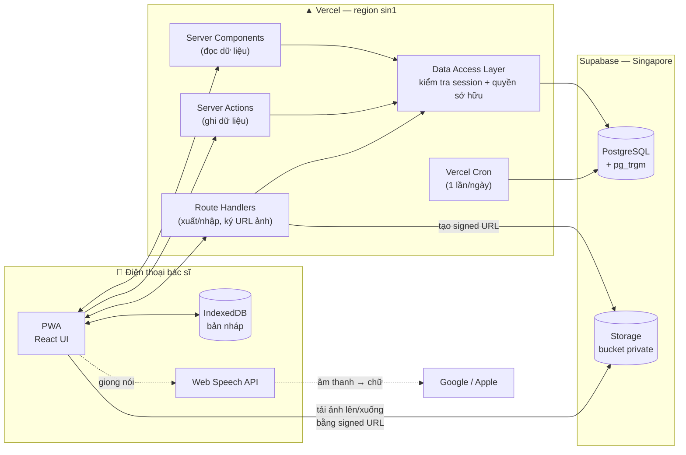
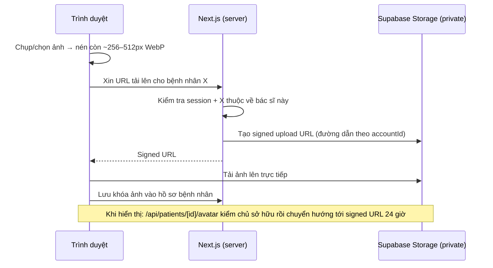
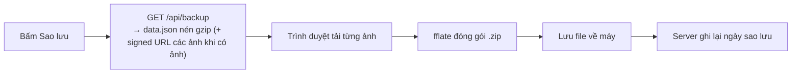
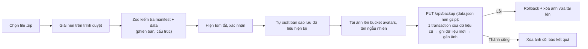
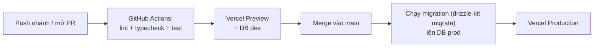

# Doctor Handbook — Đề xuất Tech Stack

> **Phiên bản:** 1.0 (bản đề xuất, chờ chủ dự án duyệt)
> **Cập nhật:** 17/11/2026
> **Dựa trên:** [idea.md](idea.md) bản 1.2. Các mã `D…`, `S…`, `N…`, `R…` dẫn chiếu tới tài liệu đó.
> **Định hướng của chủ dự án:** Next.js / React, deploy trên Vercel ✅

> ⚠️ **Lưu ý về số liệu gói miễn phí:** hạn mức và điều khoản của Vercel, Supabase, Neon... thay đổi thường xuyên. Số liệu trong tài liệu chỉ để **tham khảo khi so sánh**. **Kiểm tra lại trang giá của từng dịch vụ trước khi triển khai.**

---

## 1. Tóm tắt khuyến nghị

| Lớp | Công nghệ đề xuất | Lý do chính |
|---|---|---|
| Framework | **Next.js** (App Router, bản ổn định mới nhất) + **React** + **TypeScript** | Theo định hướng. Một codebase chứa cả giao diện và backend, deploy thẳng lên Vercel |
| Giao diện | **Tailwind CSS** + **shadcn/ui** + **lucide-react** | Component dễ tùy biến cho mobile, không khóa vào thư viện UI nặng |
| Database | **PostgreSQL trên Supabase** (khu vực Singapore) | Gói miễn phí có cả database **và** kho lưu ảnh riêng tư. Có `pg_trgm` cho tìm kiếm gần đúng |
| Truy cập dữ liệu | **Drizzle ORM** + **drizzle-kit** (migration) | Nhẹ, gần với SQL, hợp với môi trường serverless |
| Lưu ảnh | **Supabase Storage**, bucket **private** | Ảnh bệnh nhân không có link công khai (S5) |
| Xác thực | **Tự xây**: session lưu DB, cookie httpOnly, băm mật khẩu **Argon2id** | Luồng mã kích hoạt + phiên không hết hạn nhưng thu hồi được (D2, D13) không khớp sẵn với thư viện nào |
| Validation | **Zod** | Dùng chung cho form, Server Action và kiểm tra file sao lưu |
| Form | **React Hook Form** | Form bệnh nhân nhiều trường, cần nhẹ trên điện thoại |
| Tìm kiếm | Cột text **đã bỏ dấu** + index **`pg_trgm`**, lọc tức thì phía client cho tên | Không cần dịch vụ tìm kiếm riêng (D11) |
| Giọng nói | **Web Speech API** của trình duyệt | Miễn phí, không cần thư viện (D11) |
| PWA | Manifest có sẵn của Next.js + **Serwist** (service worker) | Cài lên màn hình chính, cache giao diện |
| Nháp offline | **IndexedDB** qua `idb-keyval` | Không mất ghi chú khi mất mạng |
| Sao lưu / nhập | File **.zip** đóng gói ngay trên trình duyệt bằng **fflate** | Né giới hạn kích thước request/response của Vercel |
| Nén ảnh | `createImageBitmap` + canvas của trình duyệt | Cắt vuông, thu nhỏ 384 px, nén WebP trên điện thoại trước khi tải lên. Không cần thư viện (change `add-patient-avatars`) |
| Ngày giờ | **date-fns** (locale `vi`) | Hiển thị theo giờ Việt Nam |
| Kiểm thử | **Vitest** (unit) + **Playwright** (E2E) | Bắt buộc có test chặn truy cập chéo dữ liệu (S3) |
| Hosting | **Vercel Hobby**, function đặt tại **Singapore (`sin1`)** | Theo định hướng, độ trễ thấp về Việt Nam |
| Mã nguồn & CI | **GitHub** + tích hợp Vercel (tự deploy) + **pnpm** | |

**Chi phí dự kiến: 0 đồng/tháng** ở quy mô nhóm nhỏ (mục 7).

---

## 2. Các yêu cầu quyết định việc chọn công nghệ

| Yêu cầu (từ idea.md) | Ràng buộc kỹ thuật |
|---|---|
| D1: miễn phí, nội bộ | Tất cả dịch vụ phải có gói miễn phí đủ dùng. **Không cần thẻ tín dụng** là một điểm cộng |
| D2: Admin cấp mã kích hoạt 72 giờ, bác sĩ tự đặt tên đăng nhập + mật khẩu | Luồng đăng ký **không chuẩn**. Thư viện auth chỉ hỗ trợ một phần |
| D13: đăng nhập mãi nhưng **thu hồi được** (khóa tài khoản, đặt lại mật khẩu) | Bắt buộc **session lưu trong database**. Loại trừ JWT không thu hồi được |
| D8, D20: sao lưu ra **một file**, nhập lại theo kiểu **tất cả hoặc không** | Cần transaction trong DB. File có thể lớn (có ảnh) |
| D11: tìm không dấu, tìm gần đúng, tìm trong ghi chú | Database hỗ trợ tìm kiếm theo trigram, hoặc tự xử lý |
| S5: ảnh riêng tư | Kho lưu trữ có bucket private và link có thời hạn |
| N6: Admin không xem dữ liệu bệnh nhân | Phân quyền rõ ràng ở tầng truy cập dữ liệu |
| Dùng tại Việt Nam, trên điện thoại | Server gần Việt Nam (Singapore). Giao diện nhẹ |
| R11: một người phát triển | Ít dịch vụ, ít thành phần, một codebase |

---

## 3. Kiến trúc tổng thể

**Một ứng dụng Next.js full-stack duy nhất** (monolith). Không tách backend riêng.



**Nguyên tắc kiến trúc:**

| # | Nguyên tắc | Lý do |
|---|---|---|
| K1 | **Mọi truy cập dữ liệu đi qua Data Access Layer (DAL).** Mỗi hàm DAL tự lấy `accountId` từ session, **không bao giờ nhận `accountId` từ client** | Chặn lỗi truy cập chéo (S3) tại một chỗ duy nhất |
| K2 | Đọc bằng Server Components, ghi bằng Server Actions | Ít code API, an toàn kiểu dữ liệu từ đầu đến cuối |
| K3 | Route Handlers chỉ dùng cho những việc Server Action làm không tiện: xuất dữ liệu, tạo URL tải ảnh | |
| K4 | **Ảnh và file lớn đi thẳng giữa trình duyệt và Storage**, không đi qua function của Vercel | Vercel giới hạn kích thước body của function (khoảng 4,5 MB) |
| K5 | Middleware chỉ kiểm tra nhanh "có cookie hay không" để chuyển hướng. **Kiểm tra quyền thật sự nằm ở DAL** | Theo khuyến nghị của Next.js: không dựa vào middleware để bảo mật |

---

## 4. Chi tiết từng lớp

### 4.1 Framework: Next.js + TypeScript ✅

| | |
|---|---|
| **Vì sao hợp** | Một codebase cho cả giao diện bác sĩ, giao diện Admin và backend. Server Actions giảm lượng code API. Vercel là nền tảng chính chủ của Next.js nên deploy không cần cấu hình |
| **Cách dùng** | App Router. Hai nhóm route: `(doctor)` và `admin`. TypeScript chế độ `strict` |
| **Cần lưu ý** | Phần lớn màn hình sổ tay là **tương tác phía client** (gõ tìm, thêm ghi chú). Không cố đưa mọi thứ lên Server Component. Server Component dùng cho tải dữ liệu ban đầu, client component cho tương tác |

### 4.2 Giao diện: Tailwind CSS + shadcn/ui

| | |
|---|---|
| **Vì sao hợp** | shadcn/ui sao chép mã component vào dự án (dựa trên Radix UI), nên tùy biến tự do cho mobile: nút to, vùng bấm lớn, bảng điều khiển trượt từ dưới lên (bottom sheet). Có sẵn component truy cập tốt (accessibility) |
| **Phương án khác** | **MUI / Ant Design**: đầy đủ nhưng nặng, mang phong cách máy tính, khó làm giao diện mobile gọn. **Mantine**: tốt, nhưng shadcn/ui phổ biến hơn trong hệ sinh thái Next.js |
| **Lưu ý** | Thiết kế mobile-first ngay từ đầu (N3). Chữ cơ bản tối thiểu 16px để iPhone không tự phóng to khi chạm vào ô nhập |

### 4.3 Database: PostgreSQL trên Supabase

#### So sánh các lựa chọn miễn phí

| Tiêu chí | **Supabase** 💡 | **Neon** | Firebase | MongoDB Atlas |
|---|---|---|---|---|
| Loại | PostgreSQL | PostgreSQL | NoSQL (Firestore) | NoSQL |
| Dung lượng DB miễn phí (tham khảo) | ~500 MB | ~0,5 GB | ~1 GB | ~512 MB |
| **Kho lưu ảnh đi kèm** | ✅ Có (~1 GB), bucket private | ❌ Phải dùng thêm dịch vụ khác | ⚠️ Storage hiện yêu cầu gói trả theo dùng | ❌ |
| Tìm gần đúng (`pg_trgm`) | ✅ | ✅ | ❌ Không có full-text | ⚠️ Atlas Search, cấu hình riêng |
| Transaction cho nhập dữ liệu | ✅ | ✅ | ⚠️ Giới hạn | ✅ |
| Khu vực Singapore | ✅ | ✅ | ✅ | ✅ |
| Hành vi khi không hoạt động | ⚠️ **Tạm dừng dự án sau ~1 tuần không có truy cập**, phải bật lại thủ công | Tự ngủ sau vài phút, request đầu tiên chậm hơn (~0,5–1 giây) rồi chạy bình thường | Không | Không |
| Số dự án miễn phí | 2 (đủ cho dev + prod) | Có hỗ trợ **branch** DB, rất tiện cho môi trường thử | | |
| Tích hợp Vercel | Có (Marketplace) | Có (Marketplace, là nền của Vercel Postgres cũ) | | |

#### Vì sao chọn Supabase

1. **Một nhà cung cấp cho cả database và ảnh riêng tư.** Với Neon, phải thêm một dịch vụ lưu ảnh (Vercel Blob, Cloudflare R2...), tức thêm một tài khoản, thêm cấu hình, thêm giới hạn cần theo dõi (R11).
2. Dữ liệu có tính quan hệ rõ ràng (tài khoản → bệnh nhân → ghi chú), hợp với SQL hơn NoSQL.
3. Có `pg_trgm` cho tìm kiếm gần đúng.
4. Hai dự án miễn phí: một cho **production**, một cho **dev/preview**.

#### Xử lý điểm yếu: tạm dừng khi không hoạt động

- Khi bác sĩ dùng hằng ngày thì dự án không bị tạm dừng.
- Rủi ro rơi vào các kỳ nghỉ dài (Tết). Phương án: một **Vercel Cron chạy 1 lần/ngày** gửi một truy vấn nhẹ để giữ dự án hoạt động. ❓ Xem câu hỏi T2.
- Dự án bị tạm dừng vẫn khôi phục được từ dashboard. Đây cũng là tình huống mà tính năng sao lưu ra file (D8) bảo vệ.

#### Cách dùng Supabase trong dự án

> 💡 **Chỉ dùng Supabase như "PostgreSQL + Storage".** Không dùng Supabase Auth, không gọi database trực tiếp từ trình duyệt.

| Thành phần Supabase | Dùng? | Ghi chú |
|---|---|---|
| PostgreSQL | ✅ | Kết nối từ server qua **connection pooler** (chế độ transaction), phù hợp serverless |
| Storage | ✅ | Bucket private, truy cập bằng signed URL do server tạo |
| Auth | ❌ | Không khớp luồng mã kích hoạt + tên đăng nhập (mục 4.5) |
| Truy vấn DB từ trình duyệt (supabase-js + RLS) | ❌ | Mọi truy vấn đi qua server và DAL. Một cơ chế phân quyền duy nhất, dễ kiểm tra |
| Realtime, Edge Functions | ❌ | Không cần |

**Lợi ích phụ:** vì chỉ dùng PostgreSQL chuẩn, sau này **chuyển sang Neon hoặc nhà cung cấp Postgres khác dễ dàng**. Chỉ phần lưu ảnh cần thay.

#### Phương án thay thế: Neon + lưu ảnh trong DB

Nếu muốn tránh hẳn việc tạm dừng dự án, có thể dùng **Neon** và **lưu ảnh đại diện trực tiếp trong PostgreSQL** (ảnh nén 256×256 WebP chỉ ~10–20 KB). Ở quy mô nhóm nhỏ (vài nghìn ảnh), dung lượng vẫn nằm trong giới hạn. Sao lưu cũng đơn giản hơn vì mọi thứ nằm trong DB.
**Nhược điểm:** không mở rộng được cho tính năng đính kèm ảnh/file vào ghi chú (Could Have). DB phình nhanh hơn.

### 4.4 ORM: Drizzle

| | **Drizzle** 💡 | Prisma | SQL thuần (`postgres.js`) |
|---|---|---|---|
| Kích thước, khởi động lạnh | Rất nhẹ | Nặng hơn | Nhẹ nhất |
| Gần với SQL | ✅ Viết như SQL, dễ dùng `pg_trgm`, `similarity()` | Phải dùng raw query cho tìm kiếm trigram | ✅ |
| An toàn kiểu dữ liệu | ✅ | ✅ | ❌ Phải tự viết kiểu |
| Migration | drizzle-kit | prisma migrate | Tự quản lý |

Chọn **Drizzle** vì tìm kiếm là tính năng cốt lõi và cần SQL đặc thù của PostgreSQL. Drizzle viết được các câu đó mà vẫn giữ kiểu dữ liệu.

### 4.5 Xác thực: tự xây, session lưu trong DB

#### Vì sao không dùng thư viện có sẵn

| Lựa chọn | Đánh giá |
|---|---|
| **Auth.js (NextAuth)** | ❌ Đăng nhập bằng mật khẩu (Credentials) **chỉ chạy với JWT**, không lưu session trong DB. Thu hồi JWT rất khó, nên **không đáp ứng D13** (khóa tài khoản phải có hiệu lực ngay) |
| **Supabase Auth** | ❌ Xoay quanh email. Luồng mã kích hoạt do Admin cấp vẫn phải tự làm. Thêm một hệ thống người dùng song song |
| **Clerk, Auth0...** | ❌ Dịch vụ bên ngoài, luồng tùy biến khó, dữ liệu người dùng nằm ở bên thứ ba |
| **Better Auth** | ⚠️ **Phương án thay thế hợp lý.** Có session trong DB, plugin tên đăng nhập, plugin Admin (khóa người dùng, thu hồi session), có giới hạn số lần thử. Luồng mã kích hoạt vẫn phải tự viết. Đổi lại phải học thêm một thư viện và chấp nhận lớp trừu tượng |
| **Tự xây** 💡 | ✅ Luồng đơn giản: tên đăng nhập + mật khẩu + session + mã. Toàn quyền kiểm soát. Làm theo hướng dẫn đã được kiểm chứng (mô hình của Lucia / "The Copenhagen Book") |

#### Thiết kế đề xuất

| Thành phần | Thiết kế |
|---|---|
| **Băm mật khẩu** | **Argon2id** (`@node-rs/argon2`, chạy được trên Node runtime của Vercel). Dự phòng: bcrypt |
| **Session** | Token ngẫu nhiên 32 byte, gửi trong **cookie `httpOnly`, `Secure`, `SameSite=Lax`**. DB chỉ lưu **giá trị băm SHA-256** của token. **Không có thời hạn** (D13) |
| **Kiểm tra session** | Mỗi request: băm token → tìm session → kiểm tra tài khoản còn `hoat_dong`. Cập nhật `lan_dung_cuoi` tối đa 1 lần/ngày để giảm ghi DB |
| **Thu hồi** | Xóa dòng session. Khóa tài khoản / đặt lại mật khẩu = xóa mọi session của tài khoản. Đổi mật khẩu = xóa session trừ session hiện tại |
| **Mã kích hoạt / đặt lại** | 8 ký tự từ bảng chữ đã bỏ ký tự dễ nhầm, sinh bằng `crypto` an toàn. DB chỉ lưu giá trị băm. Một lần dùng, hết hạn sau 72 giờ |
| **Giới hạn số lần thử** (S6) | Bảng `login_attempts` trong PostgreSQL, đếm theo IP + tên đăng nhập trong cửa sổ thời gian. Không cần thêm Redis |
| **Tài khoản Admin** | Tạo bằng script seed từ biến môi trường `ADMIN_USERNAME`, `ADMIN_PASSWORD`. Chạy lại script để đặt lại mật khẩu Admin (R6) |
| **Chống CSRF** | Server Actions của Next.js đã kiểm tra Origin. Route Handlers ghi dữ liệu cũng kiểm tra Origin |

### 4.6 Lưu ảnh đại diện



- Đường dẫn ảnh dạng `<accountId>/<patientId>.webp`. Ảnh không đoán được và không có link công khai.
- Ảnh không đi qua function của Vercel (K4), nên không vướng giới hạn kích thước.
- Tên file ngẫu nhiên, đổi mỗi lần đổi ảnh. URL ký sống 24 giờ, và lệnh chuyển hướng được trình duyệt nhớ 23 giờ: mỗi ảnh chỉ tải lại khoảng một lần mỗi ngày, mỗi máy, nên băng thông nằm trong gói miễn phí (change `add-patient-avatars`).

### 4.7 Tìm kiếm tiếng Việt

**Ý tưởng chính:** chuẩn hóa văn bản về dạng **không dấu, chữ thường** bằng một hàm duy nhất, dùng ở **cả lúc lưu và lúc tìm**.

```ts
// Một hàm duy nhất, dùng chung client + server
export const normalizeVi = (s: string) =>
  s.normalize("NFD")
   .replace(/[̀-ͯ]/g, "")
   .replace(/đ/g, "d").replace(/Đ/g, "D")
   .toLowerCase().trim();
```

> 💡 Chuẩn hóa không dấu đã giải quyết phần lớn lỗi nhận dạng giọng nói: "Hưng" và "Hùng" đều thành `hung`.

| Thành phần | Cách làm |
|---|---|
| Lưu trữ | Bảng `patients` có cột `search_text` (họ tên + quê + SĐT + mã BN, đã chuẩn hóa). Bảng `notes` có `search_text` của nội dung. App tính khi ghi. Không dùng extension `unaccent` để tránh vấn đề index |
| Index | **GIN `pg_trgm`** trên các cột `search_text`. Tăng tốc cho `ILIKE '%...%'` và `similarity()` |
| **Tìm tên tức thì** | Khi mở màn hình Bệnh nhân, tải **danh sách gọn** (id, tên, năm sinh, giới, quê, ảnh). Vài trăm dòng chỉ vài chục KB. **Lọc theo tên và quê ngay trên máy theo từng phím gõ**, không chờ mạng. **Không** gửi `search_text` xuống trình duyệt: cột này có số điện thoại và mã bệnh nhân, mà danh sách không được chứa hai thứ đó (S7, spec `patient-records`; change `add-patient-search`) |
| **Tìm sâu** (SĐT, mã BN, tóm tắt, ghi chú) | Gửi lên server sau khi ngừng gõ ~300ms, từ khóa ≥ 2 ký tự. Server trả **chỉ id** và loại khớp; kết quả gộp vào danh sách, đánh dấu "khớp trong ghi chú"… không hiện nội dung |
| **Tìm gần đúng** | Khi không có kết quả khớp chính xác, dùng `similarity()` của `pg_trgm` để gợi ý "Có phải bạn tìm...?" |

Không cần Algolia, Meilisearch hay Elasticsearch ở quy mô này.

### 4.8 Tìm bằng giọng nói: Web Speech API

| | |
|---|---|
| Triển khai | Hook React nhỏ quanh `SpeechRecognition` / `webkitSpeechRecognition`, `lang = "vi-VN"`. Kết quả cuối điền vào ô tìm kiếm |
| Phát hiện hỗ trợ | Trình duyệt không có API thì **ẩn nút micro** |
| Quyền micro | Trình duyệt hỏi quyền lần đầu. Cần HTTPS (Vercel có sẵn) |
| ⚠️ Rủi ro cần thử sớm | Khi chạy ở **chế độ PWA đã cài lên màn hình chính trên iPhone**, nhận dạng giọng nói từng có lỗi hoặc không ổn định qua các phiên bản iOS. **Làm prototype và thử trên iPhone thật trong tuần đầu** (R8) |
| Thư viện | Không cần. Có thể tham khảo `react-speech-recognition` nhưng tự viết hook ~50 dòng là đủ |

### 4.9 PWA và bản nháp offline

| Thành phần | Công nghệ | Phạm vi MVP |
|---|---|---|
| Manifest (tên, icon, màu, chế độ `standalone`) | File `app/manifest.ts` có sẵn của Next.js | ✅ |
| Service worker: cache giao diện, tải nhanh | **Serwist** (kế nhiệm `next-pwa`) | ✅ cache tài nguyên tĩnh |
| Bản nháp ghi chú | **IndexedDB** qua `idb-keyval`, khóa theo `patientId`. Lưu mỗi khi gõ (debounce), xóa sau khi server xác nhận | ✅ |
| Hàng đợi gửi lại khi có mạng | Lắng nghe sự kiện `online`, gửi lại các nháp chưa lưu | ✅ |
| Xem dữ liệu khi offline hoàn toàn | Cache dữ liệu vào IndexedDB | ❌ Phase 2 |

> Không dùng `localStorage` cho nháp vì dung lượng nhỏ và có thể bị iOS xóa. IndexedDB ổn định hơn, nhất là khi app đã được cài lên màn hình chính.

### 4.10 Sao lưu và nhập dữ liệu

**Vấn đề:** function của Vercel giới hạn kích thước request/response (khoảng 4,5 MB). File sao lưu có ảnh dễ vượt mức này.
**Giải pháp:** **đóng gói và giải nén file ngay trên trình duyệt**, ảnh đi thẳng giữa trình duyệt và Storage.

**Định dạng file:** `doctor-handbook_<tên-đăng-nhập>_<yyyy-mm-dd>.zip`

```
backup.zip
├── manifest.json   ← phiên bản định dạng, ngày xuất, số lượng, phiên bản app
├── data.json       ← bệnh nhân, ghi chú, việc cần làm (không có ảnh)
└── images/
    └── <patientId>.webp
```

**Xuất:**



**Nhập:**



| Chi tiết | Ghi chú |
|---|---|
| `data.json` có kích thước bao nhiêu? | Ước tính 300 bệnh nhân + 3.000 ghi chú: khoảng 1–2 MB chữ. Đi qua Route Handler `/api/backup` (không phải Server Action, vốn giới hạn 1 MB), **nén gzip cả hai chiều**, tối đa 4 MB nén (khoảng 25 MB chữ), dưới giới hạn 4,5 MB của Vercel Function. Không cần bảng tạm hay gửi nhiều lần (change `add-data-backup`) |
| Tương thích phiên bản | `manifest.formatVersion`. Có hàm nâng cấp từng phiên bản cũ lên mới |
| Lưu file trên iPhone | Safari lưu vào ứng dụng **Tệp (Files)**. Cần **thử ở chế độ PWA** vì tải file trong chế độ standalone có thể khác trình duyệt thường |

### 4.11 Thư viện phụ trợ

| Nhu cầu | Thư viện |
|---|---|
| Kiểm tra dữ liệu | `zod` |
| Form | `react-hook-form` + `@hookform/resolvers` |
| Ngày giờ | `date-fns` + locale `vi`. DB lưu `timestamptz` (UTC), hiển thị theo `Asia/Ho_Chi_Minh`. Ngày hạn của todo dùng kiểu `date` |
| Thông báo nhỏ (toast) | `sonner` (đi kèm shadcn/ui) |
| Icon | `lucide-react` |
| Nén ảnh | Không dùng thư viện: `createImageBitmap` + canvas |
| Zip | `fflate` |
| IndexedDB | `idb-keyval` |
| Tự nhận diện link trong text | Hàm nhỏ tự viết hoặc `linkify-react` |

> 💡 **Không thêm** thư viện quản lý state toàn cục (Redux, Zustand) hay TanStack Query ở MVP. Server Components + Server Actions + state cục bộ của React là đủ. Chỉ thêm khi thực sự cần.

---

## 5. Hạ tầng và triển khai

### 5.1 Môi trường

| Môi trường | Vercel | Database / Storage | Ghi chú |
|---|---|---|---|
| **Local** | `pnpm dev` | Dự án Supabase **dev**, hoặc Postgres chạy bằng Docker | |
| **Preview** (mỗi Pull Request) | Preview Deployment tự động | Dự án Supabase **dev** | ⚠️ **Tuyệt đối không trỏ Preview vào DB production**. Đặt biến môi trường riêng cho Preview trên Vercel |
| **Production** | Nhánh `main` | Dự án Supabase **prod** | |

### 5.2 Cấu hình Vercel

| Mục | Giá trị |
|---|---|
| Gói | **Hobby** (miễn phí) |
| Function region | **`sin1` (Singapore)**, cùng khu vực với Supabase. Mặc định của Vercel là Mỹ, **phải đổi**, nếu không mỗi truy vấn DB đi vòng qua Thái Bình Dương |
| Runtime | **Node.js** (không dùng Edge), vì Argon2 và driver Postgres cần Node |
| Cron | 1 job/ngày giữ Supabase hoạt động (nếu chọn ở T2) |
| Biến môi trường | `DATABASE_URL`, `SUPABASE_URL`, `SUPABASE_SERVICE_ROLE_KEY` (**chỉ dùng phía server**), `ADMIN_USERNAME`, `ADMIN_PASSWORD`, `CRON_SECRET` |
| Domain | Dùng tên miền `*.vercel.app` miễn phí, hoặc gắn tên miền riêng nếu có |

> ⚠️ **Điều khoản Vercel Hobby:** gói Hobby dành cho mục đích **cá nhân, phi thương mại**. Dự án nội bộ miễn phí hiện tại phù hợp tinh thần này. Nếu sau này có thu phí hoặc dùng chính thức cho tổ chức, cần xem lại điều khoản (gói Pro có tính phí).

### 5.3 Quy trình deploy



- Migration chạy **trước** khi bản mới nhận traffic. Cách đơn giản: lệnh build trên Vercel cho production là `drizzle-kit migrate && next build`. Migration phải theo hướng **chỉ thêm** (thêm cột, thêm bảng) để bản cũ và bản mới chạy song song được trong lúc chuyển giao.
- Script seed Admin chạy được nhiều lần mà không tạo trùng.

---

## 6. Ánh xạ yêu cầu bảo mật (S1–S9) sang công nghệ

| # | Yêu cầu | Thực hiện |
|---|---|---|
| S1 | HTTPS | Vercel cấp sẵn. Thêm header HSTS |
| S2 | Băm mật khẩu, mã | Argon2id cho mật khẩu. SHA-256 cho token session và mã kích hoạt |
| S3 | Lọc dữ liệu theo bác sĩ | **DAL (K1)** + **test E2E truy cập chéo**: tài khoản A gọi ID của B phải nhận 404 |
| S4 | Admin không đọc dữ liệu bệnh nhân | DAL tách hai nhóm hàm: `doctor/*` yêu cầu vai trò bác sĩ, `admin/*` chỉ chạm bảng tài khoản và mã. Admin không có route nào tới bệnh nhân |
| S5 | Ảnh riêng tư | Bucket private + signed URL ngắn hạn |
| S6 | Giới hạn số lần thử | Bảng `login_attempts` |
| S7 | Danh sách không lộ tóm tắt | Truy vấn danh sách không chọn cột `tom_tat` |
| S8 | Session thu hồi được | Session lưu DB (mục 4.5) |
| S9 | Lưu ý sử dụng | Màn hình kích hoạt + lưu thời điểm đồng ý |
| Thêm | Không lộ dữ liệu qua log | Không log nội dung request. Không gửi dữ liệu bệnh nhân vào công cụ theo dõi lỗi |
| Thêm | Header bảo mật | CSP, `X-Frame-Options: DENY`, `Referrer-Policy` cấu hình trong `next.config` |
| Thêm | Khóa bí mật | `SUPABASE_SERVICE_ROLE_KEY` chỉ ở server, không bao giờ có tiền tố `NEXT_PUBLIC_` |

---

## 7. Giới hạn gói miễn phí và ước tính dung lượng

**Giả định quy mô:** 20 bác sĩ × 300 bệnh nhân × 10 ghi chú (idea.md A1, A2).

| Hạng mục | Ước tính | Giới hạn miễn phí (tham khảo) | Đánh giá |
|---|---|---|---|
| Dữ liệu text (bệnh nhân + ghi chú + todo + index) | ~30–60 MB | Supabase DB ~500 MB | ✅ Dư nhiều |
| Ảnh đại diện (6.000 ảnh × ~30 KB) | ~180 MB | Supabase Storage ~1 GB | ✅ |
| Băng thông ảnh (ảnh được cache trên máy) | Thấp | Supabase ~5 GB/tháng | ✅ |
| Lượt gọi function | Vài nghìn đến vài chục nghìn/tháng | Vercel Hobby dư cho quy mô này | ✅ |
| Kích thước body function | data.json ~1–2 MB | ~4,5 MB | ✅ (ảnh không đi qua function) |

> Kết luận: quy mô nhóm nhỏ chỉ dùng **dưới 20%** hạn mức miễn phí. Điểm cần theo dõi duy nhất là **dung lượng ảnh**, nên giữ ảnh nén nhỏ.

---

## 8. Kiểm thử và chất lượng mã

| Loại | Công cụ | Trọng tâm |
|---|---|---|
| Unit | **Vitest** | `normalizeVi`, sinh và kiểm tra mã kích hoạt, schema file sao lưu, nâng cấp phiên bản file |
| E2E | **Playwright** (giả lập mobile) | Kích hoạt tài khoản → đăng nhập → thêm bệnh nhân → tìm không dấu → sao lưu → nhập lại. **Test truy cập chéo giữa hai bác sĩ** (S3). Khóa tài khoản làm mất session ngay |
| Kiểm tra tĩnh | **TypeScript strict** + **ESLint** + **Prettier** | Chạy trong CI |
| Thử trên thiết bị thật | iPhone (Safari + PWA), Android (Chrome + PWA) | Giọng nói, lưu file sao lưu, cài lên màn hình chính |

---

## 9. Cấu trúc thư mục đề xuất

```
doctor-handbook/
├── src/
│   ├── app/
│   │   ├── (auth)/            # đăng nhập, kích hoạt, quên mật khẩu
│   │   ├── (doctor)/          # bệnh nhân, việc cần làm, cài đặt
│   │   ├── admin/             # mã truy cập, tài khoản
│   │   ├── api/               # route handlers: backup, ảnh, cron
│   │   └── manifest.ts
│   ├── components/            # ui/ (shadcn), patient/, todo/, ...
│   ├── server/
│   │   ├── auth/              # session, mật khẩu, mã, giới hạn thử
│   │   ├── dal/               # doctor/*, admin/* — nơi DUY NHẤT truy vấn DB
│   │   ├── db/                # schema Drizzle, kết nối
│   │   └── storage/           # signed URL
│   ├── lib/                   # normalizeVi, schema Zod dùng chung, backup format
│   └── hooks/                 # useSpeechSearch, useDraft
├── drizzle/                   # migrations
├── scripts/                   # seed-admin
├── tests/                     # unit + e2e
├── idea.md
└── teckstack.md
```

---

## 10. Rủi ro kỹ thuật

| # | Rủi ro | Giảm thiểu |
|---|---|---|
| T-R1 | Supabase tạm dừng dự án khi lâu không truy cập | Cron hằng ngày (T2). Sao lưu ra file (D8) |
| T-R2 | Giọng nói không ổn định trên iPhone ở chế độ PWA | Prototype tuần đầu. Ẩn nút khi lỗi. Micro bàn phím làm dự phòng |
| T-R3 | Tải file sao lưu trong chế độ PWA trên iPhone gặp lỗi | Thử sớm. Dự phòng: mở trang sao lưu trong Safari thường |
| T-R4 | Quên đổi function region, app chậm | Đặt `sin1` ngay khi tạo dự án Vercel, ghi vào checklist |
| T-R5 | Preview dùng nhầm DB production | Biến môi trường tách riêng cho Preview, kiểm tra trước lần deploy đầu |
| T-R6 | Lỗi bảo mật do tự xây auth | Làm theo hướng dẫn đã kiểm chứng, phạm vi nhỏ, có test E2E. Phương án dự phòng: chuyển sang Better Auth |
| T-R7 | Điều khoản hoặc hạn mức gói miễn phí thay đổi | Chỉ dùng PostgreSQL chuẩn để dễ chuyển nhà cung cấp. Bác sĩ có file sao lưu |

---

## 11. Câu hỏi cần xác nhận

| # | Câu hỏi | Khuyến nghị nếu không trả lời |
|---|---|---|
| **T1** | Chọn **Supabase** (DB + Storage một chỗ, có thể tạm dừng khi lâu không dùng) hay **Neon** (không tạm dừng, ảnh lưu trong DB)? | Supabase |
| **T2** | Có dùng **cron hằng ngày** để giữ Supabase không bị tạm dừng không? | Có |
| **T3** | Tự xây xác thực hay dùng **Better Auth**? | Tự xây |
| **T4** | Bạn đã quen **Tailwind + shadcn/ui** chưa? Nếu chưa và quen thư viện khác hơn, có thể đổi | Tailwind + shadcn/ui |
| **T5** | Dùng tên miền `*.vercel.app` hay có tên miền riêng? | `*.vercel.app` |

---

## 12. Bước tiếp theo

1. Bạn duyệt tech stack, trả lời T1–T5 nếu muốn.
2. **Spike kỹ thuật (1–2 ngày)** trước khi làm thật, để gỡ rủi ro lớn nhất:
   - Trang Next.js tối thiểu deploy lên Vercel `sin1`, kết nối Supabase Singapore. Đo thời gian phản hồi từ Việt Nam.
   - Nút micro Web Speech API tiếng Việt, thử trên **iPhone (Safari + PWA)** và Android.
   - Tải file .zip trong chế độ PWA trên iPhone.
3. Quay lại quy trình sản phẩm: **Phase 3 — Business & Functional Analysis**. Tech stack này có thể điều chỉnh ở Phase 6 nếu Phase 3–5 phát sinh yêu cầu mới.
